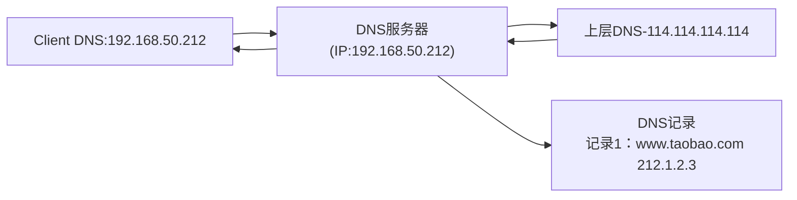

[↩️ 返回本阶段首页](../01-Linux-Cloud-Ops-Junior.md)
# 1.进程的概念

- 进程：是正在运行的程序的实例，即一个程序运行在内存中的实例。**每运行一个程序，后台可能会有一个或者多个进程。**

> [!note]
> 下面对进程进行不同角度的分类

- 如果按照运行方式与交互分类
	- **前台进程**：在当前中终端持续运行，无法执行其他命令，只能等该进程结束或者被中断，例如`ping www.baidu.com`，会持续在前台运行，如果不中断，就会一直持续输出
	- **后台进程**：在后台默默运行，不会占用当前终端，当前终端可以执行其他命令，例如`nginx`命令
	- **守护进程**：**一种特殊的后台进程**，通常在系统启动时运行，一直常驻内存，直到系统关机。**它们脱离了终端（TTY）的控制**。通常以 `d` 结尾，比如 `sshd`、`httpd`、`crond`。

- 如果按照父子关系进行分类：子进程会继承父进程(PPID)的属性信息
	- 父进程：启动另一个进程的进程，一般用`PPID`来进行标识。
	- 子进程：被父进程启动的进程，简单点来说就是被父进程派出去干活的那个进程

> [!tip]
> 这里说被父进程派出去干活的进程并不准确，有些情况下父进程也是干活的，但只不过前一种情况较多，这里需要明确，**父进程负责统筹和容灾，子进程负责执行具体任务。**

- 父进程派发出去的子进程结束完，会自动退出，并不是子进程自己结束的，而是父进程使得子进程结束了。


- PID：每一个进程都会分配一个ID号，Process ID即PID

- 系统运行的第一个进程，**`/usr/lib/systemd/systemd`**，**该进程是所有进程的父进程，该进程的PID永远为1，且该进程在终端运行时是无法被中断或者杀死**
```bash
UID          PID    PPID  C STIME TTY          TIME CMD
root           1       0  0 07:55 ?        00:00:01 /usr/lib/systemd/systemd --switched-root --system --deserialize 17
```

 - 系统中有2个特殊的进程：
	- **孤儿进程（没有父进程）**：不影响系统运行，不会占据系统的资源。如果出现了孤儿进程，此时系统中PID为1的进程（即`systemd`）会接管孤儿进程，然后结束掉它。
	- **僵尸进程**：如果系统产生了僵尸进程，占据进程ID和资源，某种情况下，你甚至会发现这个僵尸进程占据的CPU和内存资源会慢慢地增加。如果有大量的僵尸进程，操作系统会发生问题，卡顿的问题。**系统中如果出现僵尸进程，一定要去处理。**

> [!caution]
> 如果想要杀死僵尸进程，只能杀死它的父进程 
> - 僵尸进程的产生是由于子进程先一步退出，即意外退出，但是并没有真的完全退出。正常的子进程退出是，父进程发送信号使得子进程退出
> - 如果杀死该进程，仍然无法删除，因为僵尸进程本身就是退出的，只不过没有完全退出而已，杀死一个退出的进程是没有意义的


# 2.进程查询

- 进程查询主要分为两类
	- 静态查询
	- 动态查询

## ps

- `ps`：静态查询进程，并不是实时查看进程，可以直接执行
```bash
ps
```

这里的bash，指的就是bash shell，如果没有这个bash，即对该进程杀死，会直接退出当前终端，无法输入命令让bash shell转换为机器可识别的来进一步去执行
```bash
    PID TTY          TIME CMD
   1913 pts/0    00:00:00 bash
   1973 pts/0    00:00:00 dbus-launch
   2040 pts/0    00:00:00 ps
```

>[!important]
> - 只能查看当前终端的进程，其他终端的是看不到的，如果此时在其他终端又启动了其他的进程，那么需要再次执行`ps`
> - 除了上述提到的，也无法看到内核的相关进程，例如系统在启动时会自动启动很多服务，这些也是看不到的


- 输出信息具体解释：
	- `PID`：Process ID，即进程ID，每运行一个进程，系统都会分配一个PID；不可以重复，但是可以反复利用，PID被系统收回之后，下一个启动的进程可能会被分配到该PID
	- `TTY`：获取终端的方式，简单说是这个进程是在哪个终端上运行的
	    - `pts/0` 第1个伪终端，`pts`一般表示网络远程连接或者是图形化界面打开的终端（`pts/1` 第二个伪终端），随着连接不断增多，`pts`后面的数字会逐渐增加
	    - `tty`：虚拟控制台，表示有显示屏直连到服务器上
	- `TIME`：进程获取CPU的分片时间
	- `CMD`：进程产生的命令

> [!note]
> CPU给进程分配资源，是基于分片来实现的。如果这里`TIME`的值越大，表示占用CPU资源越多


**下面介绍常用选项**
- **`ps -a`** 查看所有终端的进程（**并不常用**）
>下面仅展示部分输出结果
```bash
ps -a

    PID TTY          TIME CMD
   1492 tty1     00:00:00 gnome-session-b
   1518 tty1     00:00:21 gnome-shell
   1631 tty1     00:00:00 Xwayland
   1661 tty1     00:00:01 ibus-daemon
   1664 tty1     00:00:00 ibus-dconf
   1751 tty1     00:00:00 gsd-print-notif
   1756 tty1     00:00:00 gsd-rfkill
   1759 tty1     00:00:00 gsd-screensaver
   1764 tty1     00:00:00 gsd-sharing
   1769 tty1     00:00:05 gsd-smartcard
   1777 tty1     00:00:00 gsd-sound
   1783 tty1     00:00:00 gsd-wacom
   1831 tty1     00:00:00 ibus-engine-sim
  13618 pts/0    00:00:00 ps
```

---
- `ps -ef`：
	- `-e` 与`-a`效果一致，都是显示所有进程
	- `-f`：显示父进程信息

```bash
[root@CentOS ~]# ps -ef | head -n3
UID          PID    PPID  C STIME TTY          TIME CMD
root           1       0  0 Oct26 ?        00:00:01 /usr/lib/systemd/systemd --switched-root --system --deserialize 18
root           2       0  0 Oct26 ?        00:00:00 [kthreadd]

```

---
- **`ps -aux`** ：常看所有进程详细信息
	- `-a`：所有终端进程
	- `-u`：显示额外信息，看到进程使用的CPU和内存资源等等
	- `-x`：显示内核进程（**它们不属于用户运行的进程**）
> [!note]
 > 可以简化为 **`ps aux`**

查看所有终端的进程，包括内核的进程，并显示所有进程的详细信息

```bash
ps -aux | head

USER         PID %CPU %MEM    VSZ   RSS TTY      STAT START   TIME COMMAND
root           1  0.0  0.3 252404 14916 ?        Ss   Oct26   0:01 /usr/lib/systemd/systemd --switched-root --system --deserialize 18
root           2  0.0  0.0      0     0 ?        S    Oct26   0:00 [kthreadd]
root           3  0.0  0.0      0     0 ?        I<   Oct26   0:00 [rcu_gp]
root           4  0.0  0.0      0     0 ?        I<   Oct26   0:00 [rcu_par_gp]
root           6  0.0  0.0      0     0 ?        I<   Oct26   0:00 [kworker/0:0H-events_highpri]
root           9  0.0  0.0      0     0 ?        I<   Oct26   0:00 [mm_percpu_wq]
root          10  0.0  0.0      0     0 ?        S    Oct26   0:00 [ksoftirqd/0]
root          11  0.0  0.0      0     0 ?        I    Oct26   0:01 [rcu_sched]
root          12  0.0  0.0      0     0 ?        S    Oct26   0:00 [migration/0]
```

- 下面对输出结果的各项做具体解释
	- **`USER`**：启动该进程的用户名，即进程是谁运行的，谁运行那么该进程就会拥有这个用户的权限
	- **`PID`**：进程ID
	- **`%CPU`**：进程当前占用CPU的百分比
	- `%MEM`：进程当前占用内存的百分比
	- **`VSZ`**：进程占用的虚拟内存大小，默认单位是KB
	- **`RSS`**：进程占用的真实内存大小，默认单位是KB
	- **`TTY`**：进程所关联的控制终端。如果为`?`，表示该进程没有控制终端
	- **`STAT`**：进程的当前状态码
		- `S`：休眠
		- `D`：不可中断
		- `Z`：僵尸进程
	- **`START`**：进程的开始时间
	- **`TIME`**：进程得到CPU的分片是多少
	- **`COMMAND`**：启动该进程的命令名称及参数

> [!tip]
> - `%cpu`
> 	- 如果显示接近100的数值，或者超过100的数值，并不代表就没有资源了，取决于当前这个服务器或者虚拟机的CPU核心数，如果只有一个进程显示这个数值，代表只把一个CPU的资源占据满了。
> 	- 当然对于一个多核CPU主机来说，即使有少数这样高占用的进程，也不会影响主机正常运行，操作系统在设计时，即使资源被占满，也会留下一点资源给予用户执行其他命令。**但是如果这样的进程又很多，那么就会导致系统负载过高，会使得当前系统十分卡顿，要想办法去解决。**
> - `VSZ`与`RSS`
> 	- 进程申请的内存空间实际上是虚拟内存，然后系统会转化为对应的真实内存地址空间
> 	- 如果要看进程真实占用的内存，就看`RSS`


---
- `ps -axo <format>`：按照指定格式输出
	- `user`：拥有人
	- `group`：拥有组
	- `%cpu`：占用cpu分片
	- `%mem`：内存占比
	- `pid`：进程ID
	- `ppid`：父进程ID
	- `command`：命令

```bash
[root@CentOS ~]# ps -axo user,pid,ppid,%mem,%cpu,command |head
USER         PID    PPID %MEM %CPU COMMAND
root           1       0  0.3  0.0 /usr/lib/systemd/systemd --switched-root --system --deserialize 18
root           2       0  0.0  0.0 [kthreadd]
root           3       2  0.0  0.0 [rcu_gp]
root           4       2  0.0  0.0 [rcu_par_gp]
root           6       2  0.0  0.0 [kworker/0:0H-events_highpri]
root           9       2  0.0  0.0 [mm_percpu_wq]
root          10       2  0.0  0.0 [ksoftirqd/0]
root          11       2  0.0  0.0 [rcu_sched]
root          12       2  0.0  0.0 [migration/0]
```

- `ps L` ：查看对应`ps -axo`可以接上的参数
```bash
ps L | grep comm

comm         COMMAND
command      COMMAND
ucomm        COMMAND
```

> [!note]
> 如果这里需要查看当前占用内存或者CPU最大的进程，就需要加上一个额外的选项

- `--sort`：接上`-o`后面的那些参数中的一个，默认排序是升序（从小到大），如果要降序，加上减号，`--sort=-<format>`，为演示效果，截取部分内容如下
```bash
ps -axo user,pid,ppid,%mem,%cpu,command --sort=%mem

USER         PID    PPID %MEM %CPU COMMAND
root           2       0  0.0  0.0 [kthreadd]
root           3       2  0.0  0.0 [rcu_gp]
root       14100    1913  0.1  0.0 ps -axo user,pid,ppid,%mem,%cpu,command --sort=%mem
avahi        950       1  0.1  0.0 avahi-daemon: running [CentOS.local]
root        1974    1965  0.1  0.0 /usr/libexec/openssh/sftp-server
root         952       1  0.1  0.0 /usr/sbin/irqbalance --foreground
gdm         1415    1411  0.1  0.0 (sd-pam)
root        1893    1887  0.1  0.0 (sd-pam)
rpc          905       1  0.1  0.0 /usr/bin/rpcbind -w -f
gdm         1756    1492  0.2  0.0 /usr/libexec/gsd-rfkill
root        1965    1885  0.2  0.0 sshd: root@notty
root        1908    1881  0.2  0.0 sshd: root@pts/0
root         785       1  0.3  0.0 /usr/lib/systemd/systemd-udevd
gdm         1769    1492  0.3  0.0 /usr/libexec/gsd-smartcard
root         942       1  0.3  0.0 /usr/sbin/ModemManager
root        1406    1395  0.3  0.0 gdm-session-worker [pam/gdm-launch-environment]
gdm         1735    1492  0.4  0.0 /usr/libexec/gsd-datetime
root        1132       1  0.5  0.0 /usr/sbin/NetworkManager --no-daemon
```


  

## top

- `top`：命令实时查看进程情况，下面逐项进行具体解释
```bash
top - 20:30:02 up 22:56,  1 user,  load average: 0.00, 0.00, 0.00
Tasks: 236 total,   1 running, 235 sleeping,   0 stopped,   0 zombie
%Cpu(s):  0.0 us,  0.0 sy,  0.0 ni,100.0 id,  0.0 wa,  0.0 hi,  0.0 si,  0.0 st
MiB Mem :   3902.5 total,   2633.3 free,    673.9 used,    595.2 buff/cache
MiB Swap:   4032.0 total,   4032.0 free,      0.0 used.   2985.0 avail Mem

    PID USER      PR  NI    VIRT    RES    SHR S  %CPU  %MEM     TIME+ COMMAND
   1965 root      20   0  163756   8324   7016 S   6.7   0.2   0:00.02 sshd
      1 root      20   0  252404  14916   9748 S   0.0   0.4   0:01.86 systemd
      2 root      20   0       0      0      0 S   0.0   0.0   0:00.05 kthreadd
      3 root       0 -20       0      0      0 I   0.0   0.0   0:00.00 rcu_gp
      4 root       0 -20       0      0      0 I   0.0   0.0   0:00.00 rcu_par_gp
      6 root       0 -20       0      0      0 I   0.0   0.0   0:00.00 kworker/0:0H-events_highpri
      9 root       0 -20       0      0      0 I   0.0   0.0   0:00.00 mm_percpu_wq
```

**1. 第一行解释**

```bash
top - 20:30:02 up 22:56,  1 user,  load average: 0.00, 0.00, 0.00
```

- `20:30:02`：当前的系统时间，默认是3s刷新一次，这个时间是可以动态调整的如果要更改的话，可以在进入top命令时加上参数，`top -d1`代表1s刷新一次
- `up 22:56`：系统运行了多久，也有可能是`days`，`years`等等
- `1 users` ：当前系统有多少个用户登录
- `load average: 0.00, 0.00, 0.00`：平均负载时间，有三个单位，每分钟，每5分钟，每15分钟
> [!tip]
> 平均负载与CPU数量相关
> - 拿两颗颗CPU举例子
> 	- 每分钟低于2，说明当前系统的CPU资源很空闲
> 	- 每分钟等于2，说明当前系统的CPU在全力运行
> 	- 每分钟大于2，说明当前系统的CPU超常运行 
> - 如果每15分钟的数值很大，而且维持时间很长，会导致系统十分卡顿，甚至有可能宕机

---
**2. 第二行解释**

```bash
Tasks: 236 total,   1 running, 235 sleeping,   0 stopped,   0 zombie
```

- 当前系统的进程情况
	- 一共有236个进程
	- 1个进程在运行
	- 235个进程在睡眠
	- 0个进程停止
	- 0个僵尸进程

---
**3. 第三行解释**

```bash
%Cpu(s):  0.0 us,  0.0 sy,  0.0 ni,100.0 id,  0.0 wa,  0.0 hi,  0.0 si,  0.0 st
```

> [!tip]
> 按数字`1`键列出所有CPU使用情况

```bash
%Cpu0  :  0.0 us,  0.0 sy,  0.0 ni,100.0 id,  0.0 wa,  0.0 hi,  0.0 si,  0.0 st
%Cpu1  :  0.0 us,  0.0 sy,  0.0 ni, 99.6 id,  0.0 wa,  0.4 hi,  0.0 si,  0.0 st
%Cpu2  :  0.0 us,  0.0 sy,  0.0 ni,100.0 id,  0.0 wa,  0.0 hi,  0.0 si,  0.0 st
%Cpu3  :  0.0 us,  0.0 sy,  0.0 ni,100.0 id,  0.0 wa,  0.0 hi,  0.0 si,  0.0 st
```

- 当前显示的是所有CPU的平均使用情况
	- **`us`**：CPU在用户空间的占比（用户态），如果该值较大，代表用户的应用程序吃CPU较多
	- **`sy`**：CPU在内核空间的占比（内核态），执行的一些命令
	- **`ni`**：调整过进程的优先级占据CPU资源比（nice值，即优先级）

>[!tip]
> 系统资源比较紧张的时候，优先级越高，越优先分配系统的资源，经过计算，计算之后将更多的资源分配给这个进程，CPU计算

- `id`：CPU的空闲百分比。值越大，代表当前CPU资源还很空闲
- `wa` ：CPU等待时间，实际上是等待磁盘IO的时间，值越大说明CPU和硬盘性能差距越大

> [!note]
> CPU处理数据时，只能处理内存中的数据，先从内存中读出来，然后再处理。持久化存储要写入到硬盘中。

- **`hi`**：CPU等待硬中断时间 （hard），如果这个值特别大，说明硬件在干扰你的程序运行
- **`si`**： CPU等待软中断时间 （soft），如果这个值特别大，说明软件在干扰你的程序运行
- **`st`**：被虚拟化偷取的CPU时间分片，只有当节点是虚拟化主机才关注.
> 如果某个虚拟机占用vcpu资源过大，就会导致所在的宿主机的st值变大

  
---
**4.第四行解释** 

```bash
MiB Mem :   3902.5 total,   2633.3 free,    673.9 used,    595.2 buff/cache
```

- 主要显示的是内存的相关信息（默认单位为MB）
	- 该主机共有3902.5MB的内存，与真实内存是有差距的
	- 空闲内存大小：`2633.3 free`
	- 已使用内存大小： `673.9 used`
	- 内存当中的缓存大小：缓存存在的目的是为了解决读写性能，但是这个数据会丢失，因为是内存中的数据，一旦断电数据就会丢失
> [!note]
> - 具体解释
> 	- buff：缓冲区，提高的是**系统的写性能**，CPU处理完数据后，将处理后的数据写入到buff缓冲区中，然后由buff缓冲区自己去同步数据到硬盘里
> 	- cache：缓存，提高的是**系统的读性能**，第一次从硬盘读取文件，同时会加载到cache缓存中，下一次再次读取同一个文件会直接从缓存中读取，速度会比直接到的磁盘中读取要快得多


---
**5.第五行解释**

```bash
MiB Swap:   4032.0 total,   4032.0 free,      0.0 used.   2985.0 avail Mem
```

- 主要显示的内容就是Swap分区的相关信息（默认单位为MB）
	- Swap分区总共4032.0MB空间
	- 空闲Swap空间
	- 已经使用的空间大小
	- 最后一个参数与内存参数有关 ，说的是内存可用大小，但是这里和上一行的`free`有着明显冲突，这里内存的`free`+`buff/cache`=`available`，即使清空，可能仍然存在差异，因为被系统使用的是无法清空的

---
**6.进程部分解释**

```bash
PID USER      PR  NI    VIRT    RES    SHR S  %CPU  %MEM     TIME+ COMMAND
```

- `PR`和`NI`都是代表优先级，但是二者之间存在差异
	- `PR`：内核自动调整的优先级
	- `NI`：用户调整的优先级
- `VIRT`：虚拟内存
- `RES`：真实内存
- `SHR`：共享内存，可以有效减少内存的消耗
- `S`：状态
- `TIME+`：占据CPU的时间分片
- `COMMAND`：命令不会明显，即显示命令，但是完整命令不会显示，例如后面跟上的参数之类的

---
- top常用选项
    - `-d <number>` ：指定刷新的时间
    - `-p`：指定pid 查看指定PID进程
    - **`-u`** ：用户名 查看指定用户的进程
    - `-n`：数字 指定刷新次数，刷新完后会自动退出top命令

- top界面交互操作

|  按键   | 具体含义                         |
| :---: | ---------------------------- |
| 大写`C` | 以CPU占用率排序                    |
| 大写`M` | 以内存占用率排序                     |
| 大写`P` | 以PID排序，降序                    |
| 小写`c` | 显示具体的命令                      |
| 数字`1` | 显示所有CPU的使用情况                 |
|  `f`  | 选择输出格式，通过方向键上下键选择，按空格键选定，q退出 |


  

# 3.管理与控制进程

## 信号的管理机制

- 对进程的操作实际上是通过发送不同的信号来进行实现的

- 信号常用的大概有以下几类

| 信号类型      | 含义             |
| --------- | -------------- |
| signal 15 | 正常结束           |
| signal 9  | 强制结束           |
| signal 1  | 重新加载配置文件       |
| signal 2  | 中断，相当于`Ctrl+c` |
| signal 3  | 停止，相当于Ctrl+z   |

> [!tip]
> 强制结束对于内存中的数据来说并不是很好，因为强制结束会导致内存数据丢失

- 对于signal 1做如下图解
> 对于客户端Client，将DNS指向192.168.50.212，若DNS服务器中存在如下域名解析记录

- 此时如果客户端对www.taobao.com进行访问，那么DNS服务器回到DNS记录中查找，有则会返回域名解析后的地址
- 如果查找不到对应的DNS记录，则会去上层DNS中去申请域名解析，然后将返回值传给Client客户端，并将Cache缓存保存在DNS服务器中。**如果此时第二个终端也指向同一个DNS，那么就可以直接从Cache中读取，不需要到DNS记录中去读取，速度会更快**
- 如果对相关服务进行重启，那么DNS服务器上的Cache数据就会丢失；如果对服务的配置文件重新进行加载，此时DNS服务器上的Cache数据仍然存在



## 发送信号命令

- 核心命令：`kill`，可以理解为杀死，严谨一点来说是给进程发信号
```bash
kill [SIGNAL] <Pid>
```


**1. 正常结束某个进程，即向进程发送15信号**

```bash
kill -15 PID
```
> [!tip]
> 也可以是`kill PID` ，**默认发送15信号**

- 案例演示：打开一个文件，对文件内容进行修改，**只保存不退出**，同时对对应进程发送Signal 15
```bash
ps -aux | grep vim

root       26918  0.0  0.2  47016  8220 pts/0    S+   20:15   0:00 vim passwd
root       26929  0.0  0.0  12136  1120 pts/1    S+   20:16   0:00 grep --color=auto vim
```

- 发送Signal 15
```bash
kill -15 26918
```

- 可以看到屏幕输出内容瞬间清空（即清屏），显示`Vim: Finished.`，该进程是正常退出
```bash
[root@CentOS opt]# vim passwd
Vim: Caught deadly signal TERM

Vim: Finished.


Terminated
[root@CentOS opt]#
```


---
**2. 强制结束某个进程，即发送Signal 9**

```bash
kill -9 PID
```

- 案例演示：打开一个文件，对文件内容进行修改，**只保存不退出**，同时对对应进程发送Signal 9
```bash
ps -aux | grep vim

root       26972  0.0  0.2  47016  8196 pts/0    S+   20:21   0:00 vim passwd
root       26974  0.0  0.0  12136  1104 pts/1    S+   20:21   0:00 grep --color=auto vim
```

- 发送Signal 9
```bash
kill -9 26972
```

- 由于进程是非正常结束，会导致系统来不及对内容做清理，文件内容依然显示在页面上
```bash
[root@CentOS opt]# ool/lpd:/sbin/nologin
[root@CentOS opt]# down:/sbin:/sbin/shutdown
[root@CentOS opt]# in:/sbin/halt
[root@CentOS opt]# ar/spool/mail:/sbin/nologin
[root@CentOS opt]#  Service User:/var/lib/nfs:/sbin/nologin
[root@CentOS opt]# ser for flatpak system helper:/:/sbin/nologin
[root@CentOS opt]# ib/gdm:/sbin/nologin
[root@CentOS opt]# evis Decryption Framework unprivileged user:/var/cache/clevis:/sbin/nologin
[root@CentOS opt]# :x:976:975::/run/gnome-initial-setup/:/sbin/nologin
[root@CentOS opt]# /sbin/nologin
[root@CentOS opt]# er:/home/user:/bin/bash
[root@CentOS opt]# /home/user1:/bin/bash
[root@CentOS opt]#
[root@CentOS opt]#
~
~
```


- 再次打开这个文件时，刚刚保存的文件，由于强制关闭进程，会产生一个`.swap`的交换文件
```bash
E325: ATTENTION
Found a swap file by the name ".passwd.swp"
          owned by: root   dated: Wed Oct 28 20:21:36 2026
         file name: /opt/passwd
          modified: no
         user name: root   host name: CentOS.example.com
        process ID: 26972
While opening file "passwd"
             dated: Wed Oct 28 20:21:32 2026

(1) Another program may be editing the same file.  If this is the case,
    be careful not to end up with two different instances of the same
    file when making changes.  Quit, or continue with caution.
(2) An edit session for this file crashed.
    If this is the case, use ":recover" or "vim -r passwd"
    to recover the changes (see ":help recovery").
    If you did this already, delete the swap file ".passwd.swp"
    to avoid this message.

Swap file ".passwd.swp" already exists!
[O]pen Read-Only, (E)dit anyway, (R)ecover, (D)elete it, (Q)uit, (A)bort:
```


> [!caution]
> 如非必要，不要使用强制结束。强制结束某一个进程，会产生很多的脏数据


- 对于某些服务在启动时会有很多的进程，如果想一次性删除所有相关进程，执行下面命令，默认是发送signal 15，根据“进程名称”来结束（杀死）所有匹配的进程。
```bash
killall <process name>
```


## 进程优先级

- 前面提到过优先级分为两种
	- 静态优先级：管理员手动调整
	- 动态优先级：系统内核自动调整

- nice值表示优先级，范围是`-20~19` 数字越小，数字越小，优先级越高，意味着得到更多的CPU时间分片，**不手动设置的话，默认是0**
```bash
[root@CentOS opt]# ps -axo %cpu,%mem,command,ni |head -n 5
%CPU %MEM COMMAND                      NI
 0.0  0.3 /usr/lib/systemd/systemd --   0
 0.0  0.0 [kthreadd]                    0
 0.0  0.0 [rcu_gp]                    -20
 0.0  0.0 [rcu_par_gp]                -20
```

> [!important]
> 注意：只有root用户才能修改进程的优先级

- 当进程已经启动时，使用`renice` 修改
```bash
renice -n <number> <Pid> 
```

- 指定优先级对于准备启动的进程
```bash
nice -n <number> <command>
```


## job任务

- 尝试运行firefox，直接在终端中输入`firefox`
```bash
firefox
```

```bash
[root@CentOS ~]# firefox
Failed to open connection to "session" message bus: Failed to connect to socket /tmp/dbus-PAFBGDUvWc: Connection refused
Running without a11y support!


```
>[!tip]
> 这个本质上也是一个进程，**但是会占据当前终端**，所以为了方便执行其他命令或者任务，进行下列操作


- **`&`****：在命令后加`&`，将一个进程放入后台运行
```bash
command &
```

```bash
md5sum /dev/zero &
[1] 28881
```

> [!note]
> 对于某些需要很长时间才能执行完的命令，会占用当前终端，当前终端无法再执行其他命令，需要将该进程放入后台进行运行，就不会占用当前终端


- `jobs`：查看后台运行的进程，下面的数字代表该进程的任务号
```bash
jobs

[1]+  Running                 md5sum /dev/zero &
```


- 将后台暂停/运行的任务号为1的进程在前台继续运行，若要暂停，执行`Ctrl+z`
```bash
fg %1
```

```bash
[root@CentOS ~]# fg %1
md5sum /dev/zero
^Z
[1]+  Stopped                 md5sum /dev/zero
```

- 将后台中处于“暂停状态”的 1 号任务，唤醒并让它在“后台继续运行”。**
```bash
[root@centos ~]# bg %1
[1]+ md5sum /dev/zero &

[root@centos ~]# jobs
[1]+ Running md5sum /dev/zero &
```


- 关闭后台运行的进程，即对对应进程发送对应信号
```bash
kill [Signal] %<number>
```


- 结束后后台运行的进程
```bash
kill %1

[root@CentOS ~]# jobs
[1]+  Terminated              md5sum /dev/zero
[root@CentOS ~]# jobs
[root@CentOS ~]#
```


```bash
nohup iostat 1 100 &
```

- **`iostat`** 会在后台每 1 秒采集一次系统的 CPU 使用率和磁盘 I/O 情况，共采集 100 次。
- `nohup`使后面的命令忽略挂断信号（SIGHUP），即使用户退出当前终端或关闭 SSH 会话，命令仍会在后台继续运行。