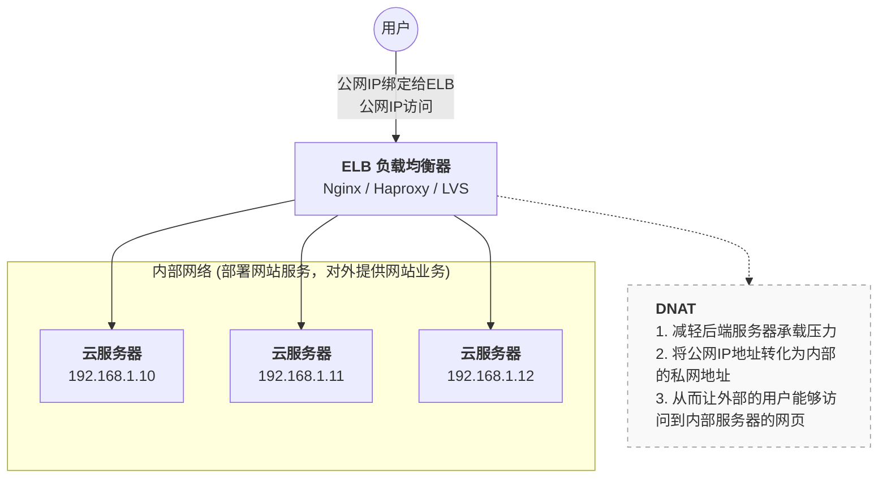

# 1.网络基本概念

## IP协议

> IP协议即（Internet Protocol）

- 作用：
    - 为网络层的设备提供一种逻辑地址（IP地址）
    - 负责将数据报包进行寻址转发

- 主要分类
    - IPv4
    - IPv6

> [!note]
> 目前截止到2025年，很多场景都逐步开始使用IPv6来替代IPv4，因为IPv4地址已经用完了，但是由于IPv4的使用较为方便，同一个IP地址可以通过添加不同的端口号来获取更多的IP地址

  

## IPv4地址

> IPv4：Internet Protocol version 4
- IP地址：IP地址在网络中用来标识一个节点（一般是网络设备的接口），用在IP报文在网络中寻址使用
- IP地址表示
    - 一个IP地址由32bit构成的（1字节 = 8bit）
    - IPv4地址通常采用点分十进制的方式来表示 例如192.168.10.1
- 进制转换 
    - 二进制转为十进制

| 2<sup>7</sup> | 2<sup>6</sup> | 2<sup>5</sup> | 2<sup>4</sup> | 2<sup>3</sup> | 2<sup>2</sup> | 2<sup>1</sup> | 2<sup>0</sup> |
| :-----------: | :-----------: | :-----------: | :-----------: | :-----------: | :-----------: | :-----------: | :-----------: |
|      128      |      64       |      32       |      16       |       8       |       4       |       2       |       1       |


- 给一个具体案例如下
```bash
11000000.10101000.00000000.00000001
```

- 具体计算如下
	- **11000000**：2<sup>7</sup> × 1 + 2<sup>6</sup> × 1 + 0 × (2<sup>5</sup> + 2<sup>4</sup> + 2<sup>3</sup> + 2<sup>2</sup> + 2<sup>1</sup> + 2<sup>0</sup>) = 128 + 64 = **192**
	- **10101000**：2<sup>7</sup> × 1 + 2<sup>6</sup> × 0 + 2<sup>5</sup> × 1 + 2<sup>4</sup> × 0 + 2<sup>3</sup> × 1 + 0 × (2<sup>2</sup> + 2<sup>1</sup> + 2<sup>0</sup>) = 128 + 32 + 8 = **168**

- 十进制转为二进制
> **利用拆分法进行计算：利用上述2的幂次去分解十进制数**

- 例如：192.168.10.1
	- 192=128+64=2^7+2^6------> 相当于是前两个数为1后面六个数都是0，即为11000000
	- 168=128+40=128+(32+8)=2^7+2^5+2^3------>10101000
- 10=8+2=2^3+2^1------>00001010

- IP地址的构成：IP地址=网络部分+主机部分
    - 网络部分：用于标识一个网络（范围）
    - 主机部分：用于表示这个网络范围内的具体的某一个主机

>[!note]
> 问题：那么通过什么来区分这两个部分？
    
- 网络掩码（子网掩码）：用于区分一个IP地址的网络部分和主机部分
    - 子网掩码构成
        - 子网掩码也是由32bit构成的
        - 是由一段连续的1和连续的0组成的
    - 子网掩码表示方法
        - 二进制表示方法
        - 点分十进制表示
        - 斜杠表示法 /24(斜杠后面的值是1的个数)

>[!note]
> 举例：255.255.255.0 由11111111.11111111.11111111.00000000转换为十进制的，有24个1


## 基本概念

- IP地址：分为两类，IPv4和IPv6
    - IP地址是一个32位的二进制数
* 两个特殊IP地址（仅作了解，例如地址段是192.168.10.0/24），这两个地址一般是不能用于分配IP地址的
	* 网关地址：192.168.10.1
	* 广播地址：192.168.10.255

- IP地址的划分
	- 私有网络：内部局域网可以访问，外面的人无法访问，里面的人也出不去
	- 公有网络：在互联网可以访问的


- 网段（IP地址网段）:类似于一个房间，房间内有多少个作为（ip地址），同网段的IP地址互相通信，不同网段的IP地址无法直接通信。
> 不同网段之间通信需要配置网关，网关一般配置在出口路由器或者交换机的接口上

> [!note]
> 引例：192.168.2.141/24
> - IP地址：1100 0000 . 1010 1000 . 0000 0010 . 1000 1101
> - 子网掩码：1111 1111 . 1111 1111 . 1111 1111 . 0000 0000
> - 异或计算：1和1比就是1，1和0就是0
> - 结果：1100 0000 . 1010 1000 . 0000 0010 . 0000 0000
> 这个结果就是网段：192.168.2.0


- 子网掩码：区分IP地址所在的网段，以及这个网段可以分配多少IP地址出去 255.255.255.0
- 网关：网关就是连接“当前局域网”和“外部网络（比如互联网）”的“大门”或“总出口”。通常设置为网段内第一个可用地址或最后一个可用地址
> 192.168.10.1或 192.168.10.254
- DNS：域名解析系统，将主机名和IP地址做解析，也可以将域名和IP地址做解析。
    - 正向解析：将主机名解析为IP地址
    - 反向解析：将IP地址解析为主机名
- 主机位：这个网段中可以分配多少IP地址
> 该案例中，**可以分配出去的IP地址 192.168.2.1 -192.168.2.254**


## 网络地址转换

>[!tip]
>关于网络地址转换，了解下面几个基本概念
- NAT:网络地址转换，将一个IP地址转化为另外一个IP地址
- SNAT:源地址转换，通常应用在内部IP想要出去上网的场景
- DNAT:目标地址转换，通常应用在前端的负载均衡器上

> [!note]
> 下面做一个基本图解与解释

- 负载均衡器，可以理解为一个实际和用户对话的一个机器，先暂时这么理解，负载均衡器后面连接着内部网络的几台云服务器，分别对应着三个不同的IP地址。当用户想去访问内部网络的云服务器时，通过公网IP将请求丢给了ELB，随之ELB将请求按照权重或者调度算法丢给了后端云服务器。**对于用户而言，访问内部服务器，只需要记住ELB的地址，对于实际地址，用户并不关心**，将目标访问地址公网IP转换为了内部地址，这就是DNAT。


  

## VLAN技术

- 特点
    - 不受地域的限制
    - 默认情况下：同VLAN间的设备可以直接进行二层通信
    - 默认情况下，不同VLAN之间的设备则是隔离状态（隔离广播报文的转发）
    - 一个VLAN就是一个广播域


# 2.网卡命名

## 网卡命名规则


> [!note]
> 这里主要是针对红帽系Linux的命名规则做解释

- 在7版本之前，使用的是传统方式网卡命名，比如eth0 eth1 ..
- 在7版本之后，使用的是基于固件设备特征命名（udev规则）命名，比如ens33 ens160 
> [!tip]
> 发生变化的原因主要是由于云计算和虚拟化的出现，因为云计算需要部署大量云主机，这些云主机底层其实和虚拟机没有什么差异，担心这个命名出现冲突


## 修改网卡命名规则为ethx

> [!tip]
> 这里修改网卡命名规则，按照个人使用习惯，可以修改也可以不修改

**1. 临时生效:只有在节点开机的时候，才可以修改**

- 按e键，进入第一个选项进行编辑
![[Pasted image 20261031194949.png|627]]


- 在`quiet`的末尾添加 **`net.ifnames=0 biosdevname=0`**，按`Ctrl +X`继续引导
 ![[Pasted image 20261031195012.png|626]]

>[!important]
> 注：重启就会失效，因为这个配置是你在开机的时候手动添加的，没有写入到配置文件，所以下一次开机的时候这两个配置是不存在的

  
**2. 永久生效：写到内核配置文件中**

- 引导配置文件：**`/boot/grub2/grub.cfg`**，开机的时候加载的内核菜单就是这个文件带来了
```bash
#
# DO NOT EDIT THIS FILE
#
# It is automatically generated by grub2-mkconfig using templates
# from /etc/grub.d and settings from /etc/default/grub
#

### BEGIN /etc/grub.d/00_header ###
set pager=1

if [ -f ${config_directory}/grubenv ]; then
  load_env -f ${config_directory}/grubenv
elif [ -s $prefix/grubenv ]; then
  load_env
fi
```

- 打开下面的配置文件
```bash
vim /etc/default/grub
```

修改下面这一行内容，增加`net.ifnames=0 biosdevname=0
```bash
GRUB_CMDLINE_LINUX="resume=UUID=f625bb36-47a6-4602-994e-7faf84f215ab rhgb quiet net.ifnames=0 biosdevname=0"
```


- `grub2-mkconfig`生成`grub.cfg`引导配置，然后重启
```bash
grub2-mkconfig -o /boot/grub2/grub.cfg

Generating grub configuration file ...
Adding boot menu entry for UEFI Firmware Settings ...
done
```


- 另有：RHEL9版本如果修改完成之后网卡的名字没有发生变化，打开下面目录类似的文件，添加如下内容
```bash
vim /boot/loader/entries/6498591b4c1d41989e040a76cc81f414-5.14.0-362.8.1.el9_3.x86_64.conf

options root=UUID=9f40c0c2-fcc0-4476-af12-d885b8831704 ro resume=UUID=f625bb36-47a6-4602-994e-7faf84f215ab rhgb quiet net.ifnames=0 biosdevname=0
```


`

  
