[↩️ 返回至虚拟网络模式](../19-虚拟网络模式/虚拟网络模式.md#3常见网络问题解决)
> [!TIP]
> **在安装虚拟机过程中，会出现各种网络不通的问题，这里关于几种情况来分别进行具体分析，主要有以下两种类型**
> - 虚拟机无法访问Internet
> - 宿主机无法ping通虚拟机


# 1.虚拟机无法访问Internet

-  常见测试方法就是ping测试，看是否可以ping通某一个网址


## 1.1  虚拟机未获取到IP地址

-  常见情况如下，这里以虚拟机只有一个网卡为例。通常就是可以看到网卡，但是网卡信息下看不到对应的网络信息，例如IP地址，子网掩码等信息

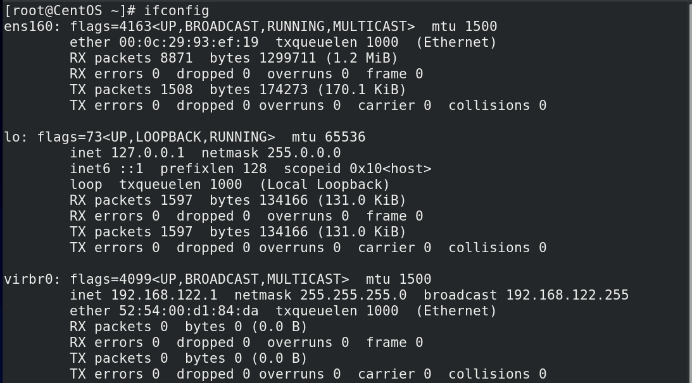

‍

-  这种情况下就是网卡没有相关的网络配置信息，解决办法大致有两种
	-  配置该网卡自动获取IP地址
	-  配置该网卡手动获取IP地址

‍

### （1）自动获取
这里按照对应命令进行配置即可
```Linux
# 自动配置IP地址
nmcli connection add type ethernet ifname ens160 con-name ens160 ipv4.method auto autoconnect yes

# 重新加载并使网卡配置生效
nmcli connection reload （对于有的系统来说，可能需要执行别的指令 systemctl daemon-reload）
nmcli connection up <con-name>

# 查看连接状态以及网卡设备状态
nmcli connection show
nmcli device status

```

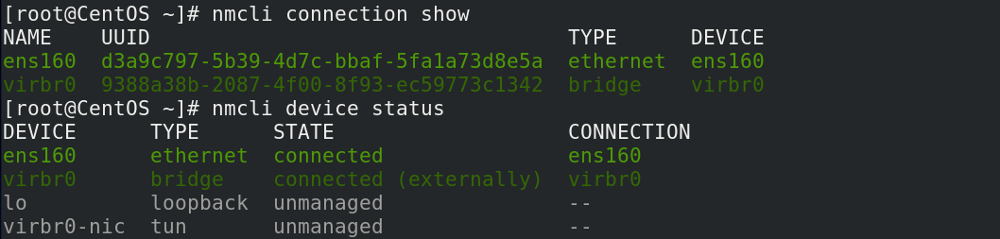

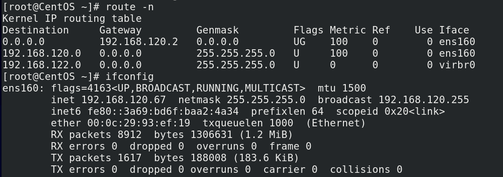

‍

- 尝试ping测试，可以正常ping通

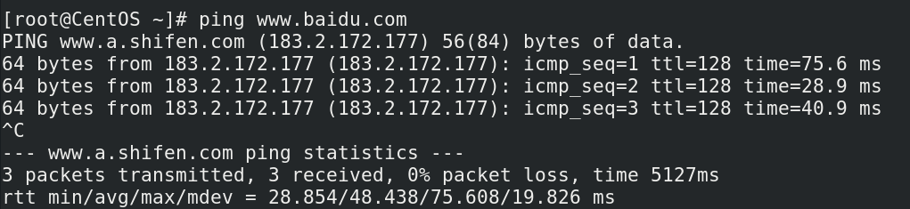

‍

- 经测试得出
	- 桥接模式：通过自动获取IP地址，可以正常访问Internet
> [!IMPORTANT]
> 注意：这里的桥接网络，在某些特殊网络中，即使通过自动获取得到了IP地址，仍然可能出现无法上网。大致有以下几种情况
>
> - 校园网：大多数情况下都做了限制，桥接网络的虚拟机意味着一台新的设备，校园网属于禁止桥接转发的网络

	- NAT模式：该模式下通过自动获取IP地址，即使关闭了对应的VMnet8的虚拟网卡，也可以正常访问Internet
	- 仅主机模式：默认就是不能访问Internet的，这种情况不做说明

‍

‍

### （2）手动获取

> [!CAUTION]
> 手动获取IP地址会出现很多问题，下面依次呈现

- 主要配置命令如下

```Linux
nmcli connection add type ethernet ifname ens160 con-name ens160 ipv4.method manual ipv4.addresses 192.168.120.45/24 ipv4.gateway 192.168.120.254 ipv4.dns 114.114.114.114 autoconnect yes
```

‍

- 请确保这里可以看到子网掩码，如果看不到，那肯定是无法上网的，<span data-type="text" style="color: var(--b3-font-color13);">确认这里配置无问题后，再进行后续检查</span>

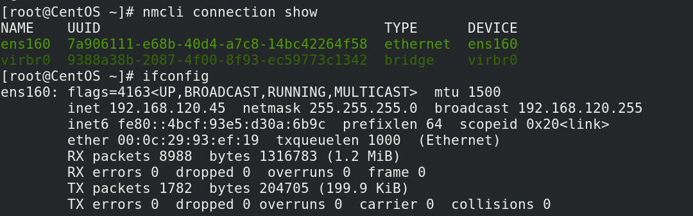

‍

- 根据上述配置完成后，发现无法访问Internet，对应的网卡信息仍然按照上述配置完成，例如IP地址，网关，DNS信息

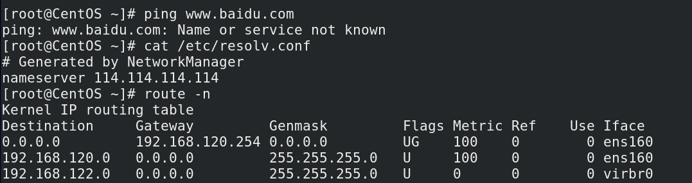

> [!TIP]
> 此种问题，如果命令没有执行错误，而在于下面几类问题

‍

- 打开VMware WorkStation的虚拟网络编辑器，下面逐项进行排查

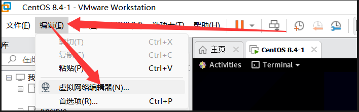

‍

#### I. 网段错误

- 这里的网段配置有如下要求

  - 命令中配置的IP地址，以及子网掩码，都要与虚拟网络编辑器中的子网和子网掩码保持一致。
  - 其次，IP地址不要配置成`x.x.x.0`​、`x.x.x.1`​、`x.x.x.255`这类地址，不要和网关地址，广播地址冲突

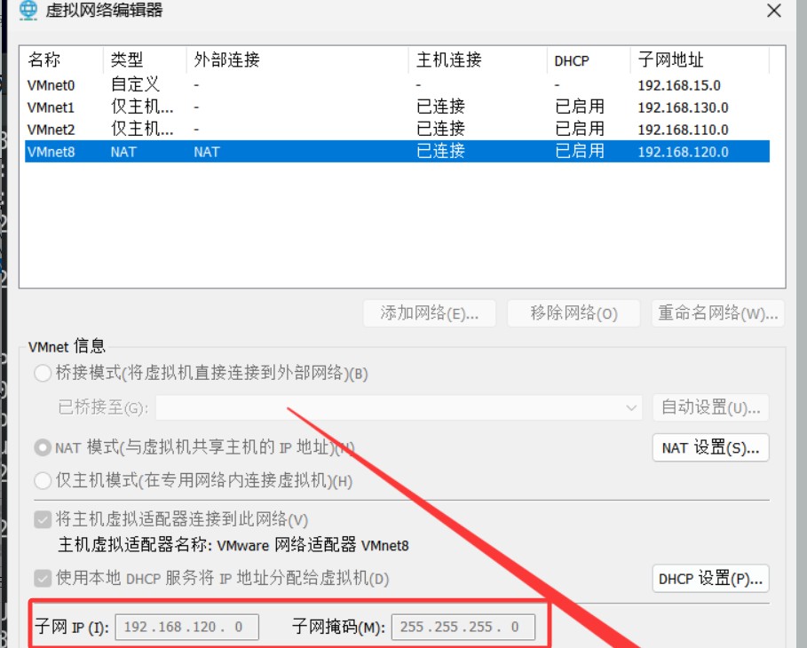

‍

‍

#### II. 网关错误

- 检查此处网关-----NAT设置

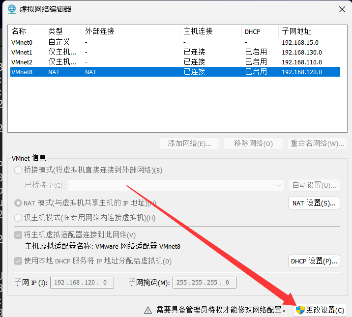

‍

- 对比刚才的命令中的192.168.120.254，网关对不上，这里两种解决办法
	1. 修改命令中的网关信息和此处虚拟网络编辑器中的网关信息一致
	2. 修改虚拟网络编辑器中的网关信息和命令中的网关信息一致

     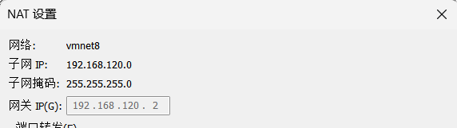

‍

‍

#### III. DNS配置存在问题

- 例如该案例中的DNS为8.8.8.8，尝试更换其他DNS地址，例如114.114.114.114，或者阿里云的公有云地址223.5.5.5

[阿里巴巴开源镜像站-OPSX镜像站-阿里云开发者社区](https://developer.aliyun.com/mirror/?spm=a2c6h.13651102.0.0.32f21b11NlBuXs&serviceType=dns)

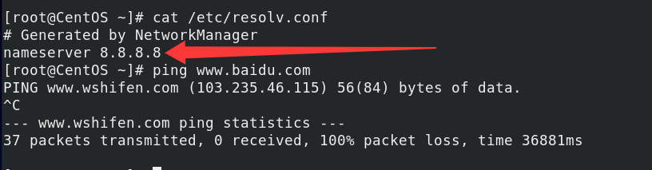

‍

‍
## 1.2  虚拟机已经获取到IP地址

- 已经获取到IP地址，就是经过上面的分析后，仍然无法ping通网络，再接着往下进行分析

### （1）存在两条路由

- 通过下列命令，查看路由表中是否存在两条路由，删除与虚拟网络编辑器中不匹配网关的路由信息

```Linux
# 查看路由表
route -n
# 删除路由信息
ip route del default via 192.168.120.254 dev ens160 metric 50
```

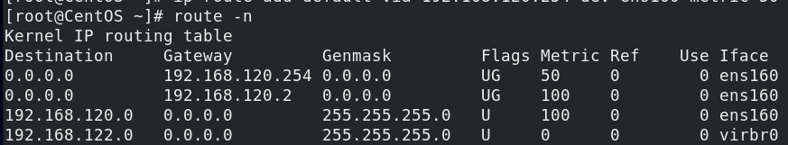

> [!IMPORTANT]
> 这种存在多条路由的情况，通常出现在一个虚拟上存在多张网卡的情况那个，虚拟机上配置了不同的IP地址信息以及网关，可能导致默认路由网关出现问题。Metric为优先级，数字越小，优先级越高

- 这里删除完后，到对应网卡的配置文件中去删除多余的网关信息，然后重启NetworkManager服务
```bash
systemctl restart NetworkManager
```


### （2）NAT服务存在异常

- 按 `Win + R`​​ 打开运行框，输入 `services.msc`​

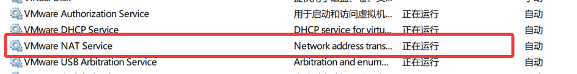

‍

- 确保VMware NAT Service为开启状态，并设置自动开启

‍

### （3）DHCP服务存在异常

- 按 `Win + R`​​ 打开运行框，输入 `services.msc`​

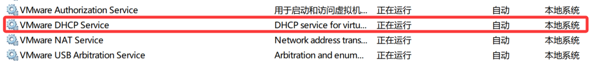

‍
- 确保VMware DHCP Service为开启状态，并设置自动开启

‍


# 2.宿主机无法ping通虚拟机

> [!TIP]
> - 宿主机无法ping通虚拟机，就会导致无法进行远程SSH连接，所以解决这个问题也是方便日常使用的关键

- 对于NAT模式网络和仅主机模式网络，下面的分析流程对于二者排查同样适用

### （1）虚拟网络适配器未开启

- 打开控制面板-----网络和Internet

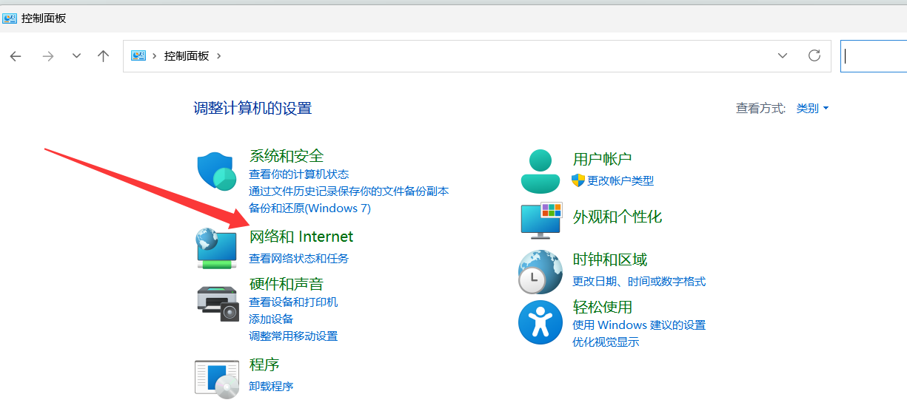

‍

- 打开网络和共享中心----更改适配器设置

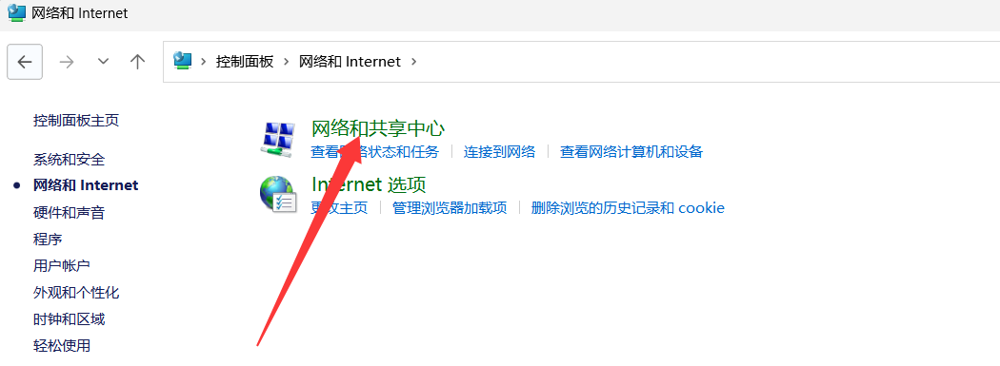

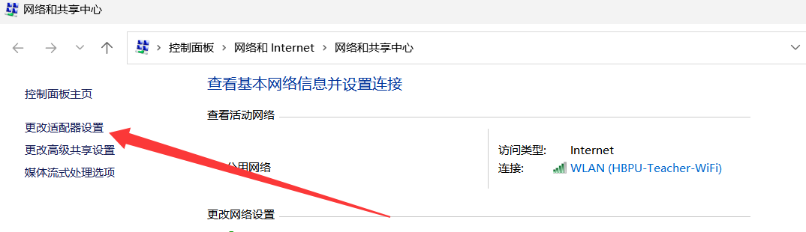

‍

- 确保VMware Network Adapter 这类的网络适配器全部处于开启状态

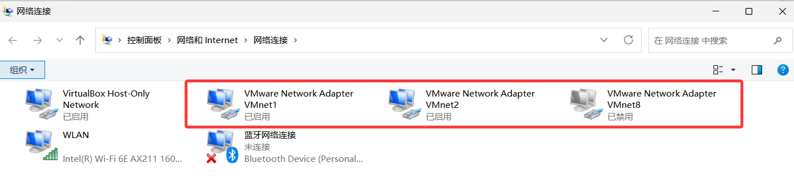

-  这里可以进行测试 ，如果开启VMnet对应的网卡，使得宿主机可以和虚拟机正常通信的话，就不需要进行下面的手动配置操作，一般情况下是可以于虚拟机正常通信的
-  如果还是不能通信的话，建议根据下面的步骤，进行手动配置


### （2）虚拟网络适配器手动配置信息

> [!IMPORTANT]
> - 虚拟网络适配器需要保持和Vmware Workstation中的虚拟网络编辑器的对应网卡配置保持一致
> - 这种情况针对于个人学习使用，如果觉得自动获取地址不太稳定的话，可以考虑对其进行手动配置，这种配置下，会较为稳定。

- 对对应模式网卡属性进行编辑，点击Internet 协议版本 4 （TCP/IPv4）

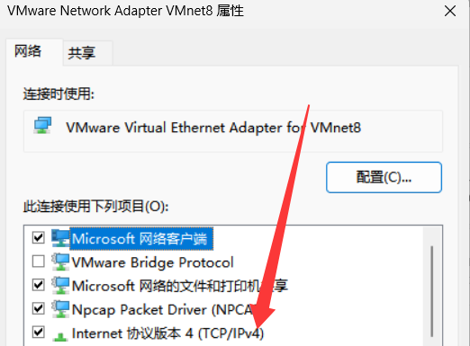

‍

- 大致有以下几个关键点

  - 对应网卡从自动配置改为手动配置

> [!tip]
> 这里如果自动配置可以正常与虚拟机通信，就可以不使用手动配置，反之，就使用手动配置
>
- 配置IP地址，子网掩码，网关

> [!CAUTION]
> - IP地址不要和虚拟机地址保持一致，或者与网关地址，广播地址冲突
> - 网关地址需要和虚拟网络编辑器中的IP地址保持一致，对于仅主机模式的网卡不需要进行配置
>
  - 配置完上述内容后，对所配置网卡禁用后，再次进行启用


### （3）防火墙阻挡流量

- 如果仍然无法ping通对应虚拟机，可能是Windows虚拟机的防火墙阻挡了Ping的数据包，到Windows安全部分关闭Windows防火墙即可


