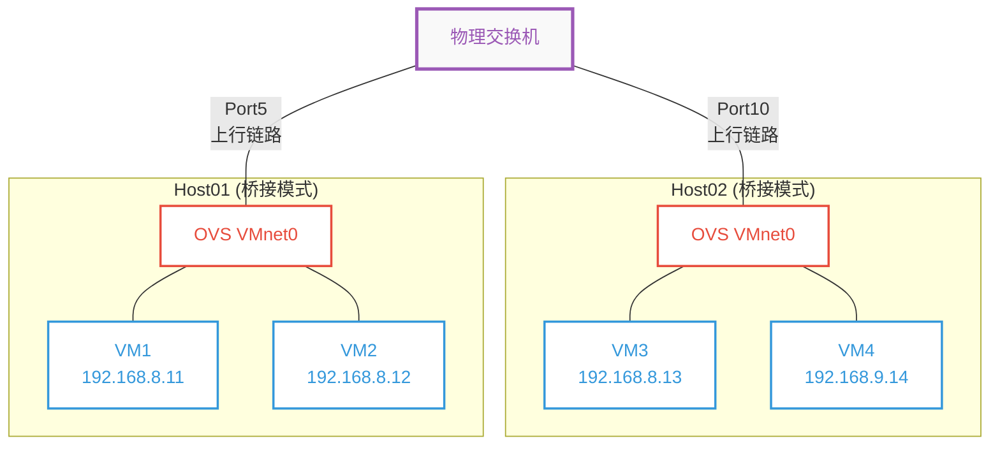
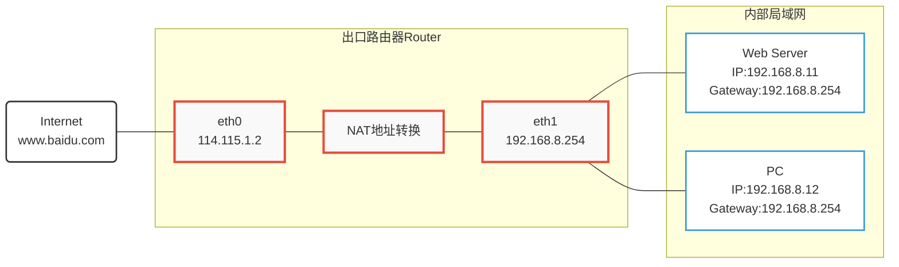
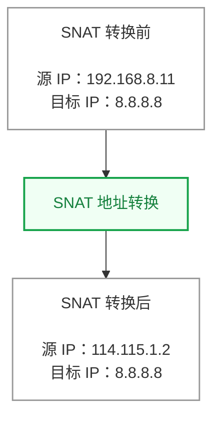
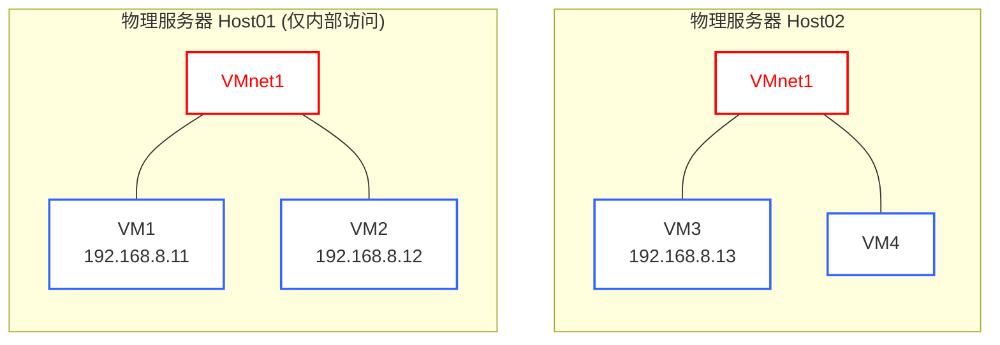
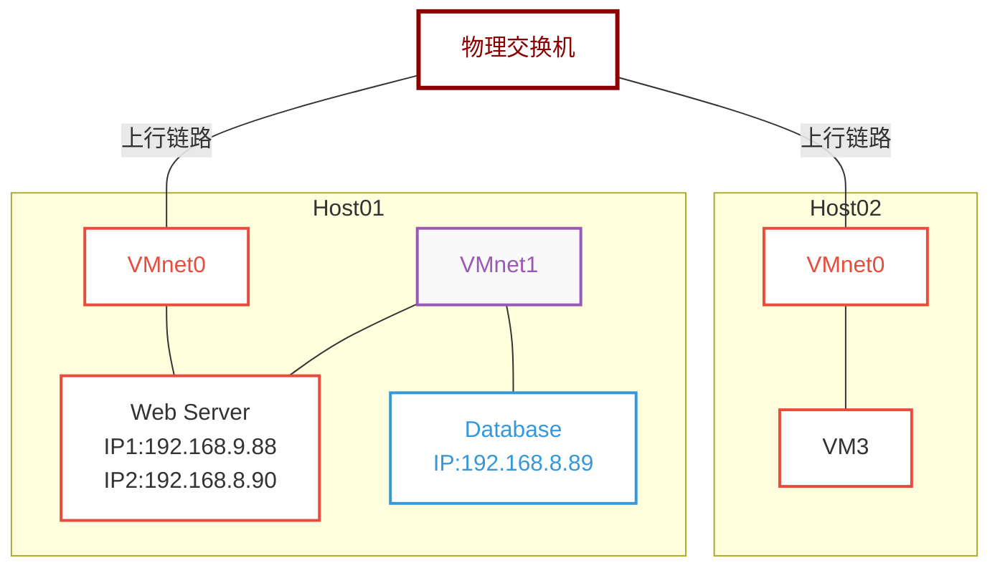
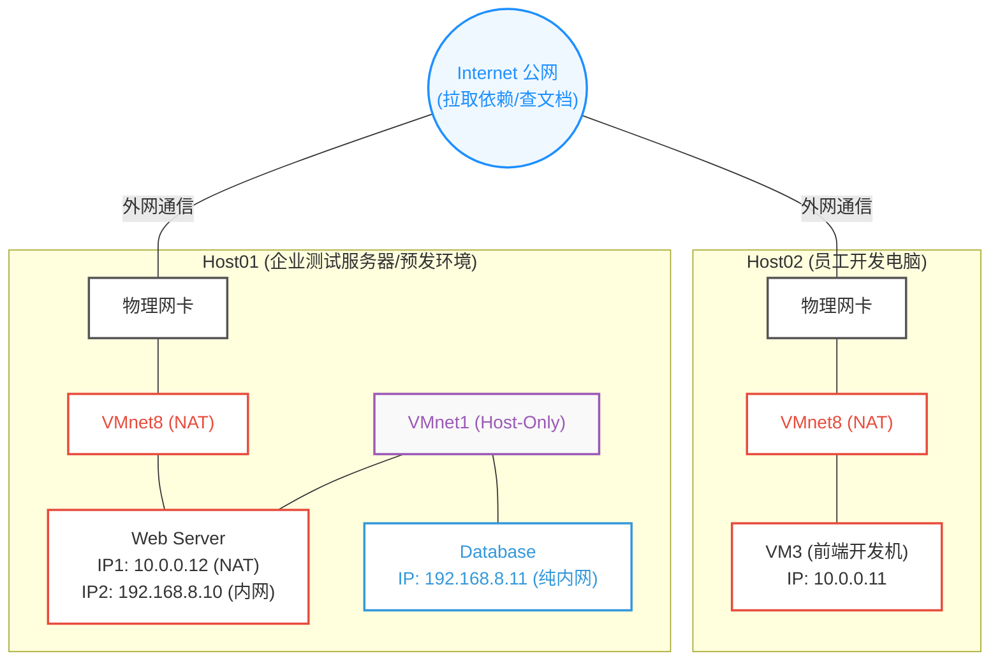
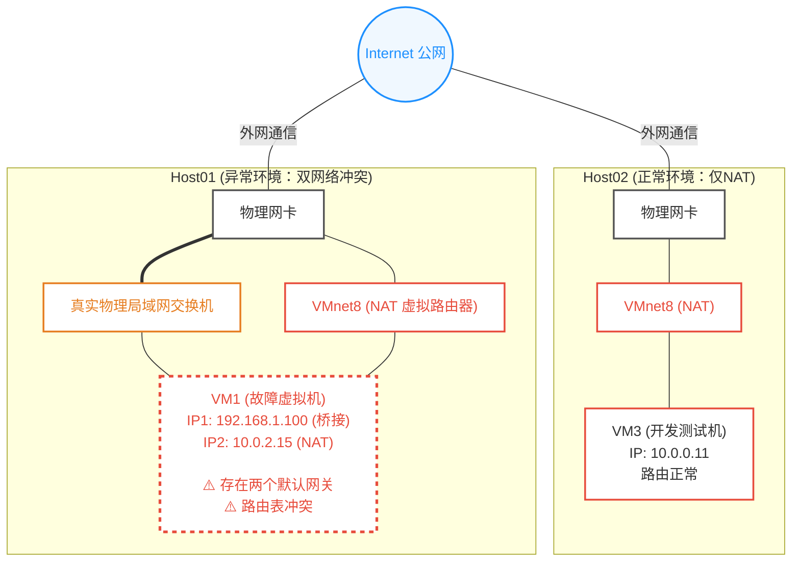

[↩️ 返回本阶段首页](../../01-Linux-Cloud-Ops-Junior.md#️-本阶段主要学习内容)
# 1.VMware的三大网络模式

- VMware Workstation是一个面向个人的虚拟化产品，了解这三大网络模式，实际上也是在了解虚拟化产品的网络模式（桥接模式，仅主机模式，NAT模式）

## 桥接模式

- 桥接模式（Bridge）：把宿主机的物理网卡当作一个虚拟交换机使用，桥接模式下的虚拟机也是可以访问Internet

- 关键网络设备
	- 虚拟交换机 vSwitch(Virtual Switch)： VMware Workstation上支持VMnet0到VMnet19共计20个虚拟交换机
	- OVS(OpenvSwitch)：就是一个开源的虚拟交换机实现。**一个OVS最多可以支持4096个虚拟端口

- 图解与解释如下
	- 虚拟化软件通过在宿主机上创建一个虚拟网桥，虚拟机的虚拟网卡通过这个网桥连接到宿主机所用的物理网卡（或者物理交换机），物理交换机有Port5和Port10两个端口用于连接主机上的虚拟交换机。
	- 对于物理网路中的路由器或者说其他设备来说，这台虚拟机就等同于一个真实的、新接入的电脑



>[!important]
> 概念解释与深度理解：
>- 上行链路：连接虚拟交换机(OVS)和物理交换机的通道，这是一根真实的网线，每一台主机有且仅有一条上行链路
>- 桥接模式的本质
>    - 当虚拟机的网络模式设置为桥接模式时，虚拟机就会通过虚拟端口连接到OVS，而OVS作为一个虚拟机网桥，将所有设备连接到一起
>- 若四台虚拟机网络模式都设置为桥接模式时，那么这四台虚拟机都会连接到OVS上 
>- 在此模式下虚拟交换机OVS实际上就是虚拟化软件提供的虚拟网桥的具体实现。作用上是等同的
>- 如果VM1和VM3要进行通信，首先VM1通过OVS，再通过上行链路连接到物理交换机的Port5端口，通过交换机内部交换，进入Port10端口，它通过上行链路连接到VM3所在主机的OVS，进而通信
>- 该拓扑图中VM4无法与其他虚拟机进行通信，由于不在同一个IP子网下，需要路由器来进行通信

- 在VMware中若网络模式为桥接模式，此处的已桥接至的选项就对应着上述所说的上行链路分别对应几个网络适配器
	- 虚拟适配器------->虚拟机的仅主机网络
	- 虚拟无线适配器：用于支持 Wi-Fi Direct 技术
	- 无线个人区域网（WPAN）适配器
	- 物理无线网卡

![[Pasted image 20261102081650.png|589]](assets/Pasted%20image%2020261102081650.png)


- 虚拟机必须要配置和物理网卡同样的网段地址才可以出去上网，因为虚拟机相当于是一台独立的电脑，网络配置也要基本一致，如果是手动配置，那么网段，子网掩码，网关信息必须要和物理网卡的信息要一致
- 桥接模式默认对应VMnet0这个网络适配器

>[!tip]
>桥接模式在实际中使用较多，**内部设备需要上网，同时外部设备也需要访问到内部服务**，就使用桥接模式

>[!caution]
>注意：有一些情况，即使设置了桥接模式，也无法访问Internet，可能是以下原因
>- 校园网：大多数情况下都做了限制，桥接网络的虚拟机意味着一台新的设备，校园网属于禁止桥接转发的网络
>- **物理网络禁止未知MAC地址**：公司或校园网可能启用了端口安全或MAC地址绑定，禁止未经注册的“新设备”（即虚拟机）接入网络。


  

## NAT模式

- NAT(Network Address Translation)：网络地址转换，是可以出去上网的，将虚拟机的内部ip地址转化为宿主机的物理网卡的IP地址出去，只要宿主机可以上网，子NAT模式下的虚拟机也一定可以上网

- 具体图解与解释如下
	- 内部局域网可以访问Internet的关键技术就是**SNAT(Source Network Address Translation)，即源地址转换**
	- 当内部网络中的服务器或者PC想要去访问Internet时，这些机器的网关都指向同一个地址，就是Router的eth1这张网卡的地址。
	- 内部主机将数据包发送给网关时，数据包的目标 IP 地址仍然是 Internet 上的目标地址，而不是网关的 IP 地址。
	- 然后将数据包的源 IP 地址进行转换，转换为出口路由器eth0这张网卡的IP地址，进而访问到Internet。



- 源地址在SNAT转换前后，只有源IP地址发生了变化，目标IP地址始终保持不变，这就是SNAT转换



>[!important]
>桥接模式与NAT模式对比
>- 访问对比
>	- 桥接模式和NAT模式，都可以使虚拟机出去访问Internet，区别在于NAT模式下的虚拟机，只可里面访问外面，外面的人是无法访问到虚拟机的
>	- 桥接模式下的虚拟机，里面可以访问外面，外面的人也是可以访问里面的
>- 网络配置
>	-  因为配置的网络信息和物理网段保持一致，所以当你的物理网卡的网段发生变化，桥接模式下的虚拟机也需要修改配置
>	- NAT模式下的虚拟机，只要不改变VMware软件的虚拟网络配置，无论如何你都可以出去上网


- 在VMware网卡自动获取IP信息的情况下，NAT模式下的网段的第一个地址是给到宿主机的VMnet8网卡，第二个地址是给到网关和DNS使用的
![[Pasted image 20261102103405.png|656]](assets/Pasted%20image%2020261102103405.png)

  
- VMware虚拟网络编辑器设置，这里可以对NAT子网，掩码，以及是否启用DHCP获取进行设置，DHCP设置中可以设置获取的地址范围
![[Pasted image 20261102110252.png|509]](assets/Pasted%20image%2020261102110252.png)


## 仅主机模式

- 仅主机模式（Host-Only）：宿主机上有一个虚拟交换机，如果都是仅主机模式下的虚拟机，之间是都可以通信的，但无法访问，无法访问外部网络---->没有上行链路

- 具体图解与解释如下
	- 虚拟化软件创建一个虚拟机网络适配器以及一个虚拟交换机（此交换机不连接任何网卡），只要虚拟机设置为仅主机模式，都会连接到这个虚拟交换机上。
	- VMnet1是仅主机模式的网卡，虽然都是同一个名称的网卡，**但是虚拟机被分布在不同的主机上，所以这些虚拟机无法跨主机进行通信，只能内部进行通信**



- 仅主机模式会有保留的IP地址，仅主机模式下的网段的第一个地址是给到宿主机的VMnet1网卡
![[Pasted image 20261102104858.png]](assets/Pasted%20image%2020261102104858.png)


>[!important]
> 无法访问外部网络，虚拟机完全无法与外界进行通信，提供最高级别的网络隔离

  

# 2.不同模式网卡结合

## 桥接模式+仅主机模式

> [!tip]
> 这种结合被使用的较多

- 网络规划如下
	- Web Server有两个IP地址，连接着两张网卡
		- VMnet0（桥接模式）：192.168.9.88
		- VMnet1（仅主机模式）：192.168.8.90
	- Database数据库一张仅主机模式网卡：192.168.8.89

- 具体图解与解释如下
	- 一台服务器上有两个网卡，一个桥接模式（访问Internet），一个仅主机模式（内部局域网），前面提到过桥接模式除了使得内部可以访问Internet之外，外部用户也可以访问
	- Host01上有两台服务器，Web Server与Database。**对于Web服务器来说，是实际提供给用户服务的**，所以需要用一张桥接模式网卡对外提供服务；对内来说，**Web服务器需要读取数据库的内容**，实际地址也需要指向内部局域网IP，所以需要一张仅主机的网卡
	- 数据库一般不需要给用户，而且也不能暴露给用户，因为不安全，**数据库里面都是核心数据，为了保证安全，只需要内部局域网，仅允许内部访问即可**




## NAT模式+仅主机模式

>[!tip]
>这种组合一般用于企业级应用测试环境

- 具体图解与解释如下
	- Web Server由于是用于测试，这里不能直接暴露真实IP地址，所以不需要对外提供服务，从结果上看，这里使用NAT与桥接无异，但是外部是无法访问Web服务器的，外部并不知道Web服务器的存在，也不需要知道
	- Database依然是核心最重要的，也不能暴露到公网的，所以用仅主机模式，内部局域网




## 桥接模式+NAT模式

- 在虚拟化网络里，如果给**同一台虚拟机**同时配置一块“桥接模式”网卡和一块“NAT模式”网卡，在实际操作中是非常**不可行**的，也是极其不推荐的

- 上面两个可以访问Internet的模式+内部局域网的形式是推荐的，因为对于桥接和NAT来说，都是要配置网关的，对于在同一个虚拟机中，是不能存在两个默认网关，两个默认网关就意味着存在两条默认路由，会发生冲突。




# 3.常见网络问题解决

- 可能经过上面的了解之后，配置网络可能依然存在问题，那么就需要进一步排查，了解基本排错与设置网络

具体详见:[常见网络问题解决](../19-Extra-常见网络问题解决/常见网络问题解决.md)


# 4.网络高可用


- 单点故障：如果一台服务器只有一个网卡，那么如果网线损坏或者网卡故障等等问题，那么此时没有任何冗余，整个业务都会停下，这对于实际生产环境是无法忍受的，所以必须要有冗余
>Avoids single point of failure （SPOF）


- 网络高可用：所谓的高可用，本质就是要防止单点故障，网卡出现了故障，网络依旧是正常提供服务的

- 默认是500ms向主网卡询问状态是否正常，当然这个时间可以进行调整

## 网络Bond

> [!note]
> 网络Bond的出现：没有网络Bond时，网卡发生故障后，用户只能手动更改访问的IP地址，手动改动又太麻烦，就出现网络bond。

- 网络Bond：是一种将多个物理网络接口（Network Interface Card, NIC）在逻辑上聚合成一个单一的虚拟网络接口的技术。使用较多的一般是双网卡绑定
>[!tip]
>简单点说，**就是把服务器上的多块物理网卡，用软件“捆绑”在一起，变成一个虚拟的“超级网卡”来用。**

- 网络Bond的核心功能，这些具体功能会在下面Bond的各种级别具体介绍
	- 冗余容错
	- 负载均衡
	- 带宽扩展

- 一般会有两种监测网卡状态的方式
	- 网卡驱动监测
	- `ethtool`来监测

```bash
ethtool
```

```bash
Settings for ens160:
        Supported ports: [ TP ]
        Supported link modes:   1000baseT/Full
                                10000baseT/Full
        Supported pause frame use: No
        Supports auto-negotiation: No
        Supported FEC modes: Not reported
        Advertised link modes:  Not reported
        Advertised pause frame use: No
        Advertised auto-negotiation: No
        Advertised FEC modes: Not reported
        Speed: 10000Mb/s
        Duplex: Full
        Auto-negotiation: off
        Port: Twisted Pair
        PHYAD: 0
        Transceiver: internal
        MDI-X: Unknown
        Supports Wake-on: uag
        Wake-on: d
        Link detected: yes  ---->正在链接监测
```


## Bond的各种级别

- 网络Bond大致有下面七种

| bond级别 | bond名称                         | bond特点                                     | 对交换机要求                         |
| :----: | :----------------------------- | :----------------------------------------- | :----------------------------- |
|   0    | round-robin                    | 按照设备顺序依次传输数据包。提供负载均衡和容错能力                  | 交换机需要配置trunking                |
|   1    | active-backup                  | 只有一个设备处理数据，当它宕机的时候就会由备份代替，仅提供容错能力          | 交换机不需要配置trunking               |
|   2    | load-balancing(xor)            | 根据MAC地址异或运算的结果来选择传输设备，提供负载均衡和容错能力          | 交换机需要配置trunking                |
|   3    | fault-tolerance<br>(broadcast) | 通过全部设备来传输所有数据，提供容错能力                       | 交换机需要配置trunking                |
|   4    | lacp                           | 通过创建聚合组来共享相同的传输速度，需要交换机也支持802.3ad模式，提供容错能力 | 需要交换机支持802.3ad、交换机需要配置trunking |
|   5    | transmit load<br>balancing     | 由负载最轻的网口发送，由当前使用的网口接收。提供负载均衡和容错能力。         | 交换机不需要配置trunking               |
|   6    | adaptive load<br>balancing     | 用负载最轻的网口进行发送和接收。提供负载均衡和容错能力。               | 交换机不需要配置trunking               |
>[!tip]
>其实在实际生产环境中较为常见的配置就下面几项

- bond0：**轮询策略**，数据包来一次走这个网卡，来一次走那个网卡，原来一张网卡承载的数据，分为多张网卡均衡承担（负载均衡），当有一张网卡挂掉了，另一张网卡也可以使用（提供容错能力）------提高高可用
- bond1：通过**主备**来容错，**但仅仅提供容错能力，不提供负载均衡**------提高高可用（主备）
- bond4：通过链路聚合来提高带宽功能，对交换机配置有特定要求
- bond6：哪个网卡更空闲就把数据丢给谁
  
>[!important]
> 这里的每一种Bond级别其实都不是完美的，关键的要看实际使用场景，不可能一个模式满足实际问题的所有需求。

  

## 配置网络Bond

- 网络bond通常是配置在服务器上，虚拟机上一般不会配置网络bond，数据最终还是要通过物理网卡出去
>[!important]
>在配置网络bond的时候，物理网卡是不需要配置IP地址的，只需要给虚拟网卡配置ip地址，物理网卡仅仅做数据包的转发

1. 为虚拟机添加两个仅主机模式网卡
>这里为了方便测试，选择仅主机模式，也可以选择的其他模式网卡进行测试，都是可以的

![[Pasted image 20261102212415.png|434]](assets/Pasted%20image%2020261102212415.png)

```bash
ens224: flags=4163<UP,BROADCAST,RUNNING,MULTICAST>  mtu 1500
        ether 00:0c:29:93:ef:2d  txqueuelen 1000  (Ethernet)
        RX packets 0  bytes 0 (0.0 B)
        RX errors 0  dropped 0  overruns 0  frame 0
        TX packets 0  bytes 0 (0.0 B)
        TX errors 0  dropped 0 overruns 0  carrier 0  collisions 0

ens256: flags=4163<UP,BROADCAST,RUNNING,MULTICAST>  mtu 1500
        ether 00:0c:29:93:ef:23  txqueuelen 1000  (Ethernet)
        RX packets 0  bytes 0 (0.0 B)
        RX errors 0  dropped 0  overruns 0  frame 0
        TX packets 0  bytes 0 (0.0 B)
        TX errors 0  dropped 0 overruns 0  carrier 0  collisions 0
```


---
2. 将要配置的网卡配置删除掉，不要有网卡的IP地址存在，这里如果没有获取到地质的网卡，就可以不用管了，直接可以进入下一步

>[!warning]
>如果在生产环境上，请你一定要备份物理网卡的配置文件。实际去做将所有的物理网卡配置删除掉，不要有任何物理网卡的IP地址

```bash
nmcli connection delete <con-name>
```

- 再次查看是否全部删除了，没有IP地址
```bash
ifconfig
```

  
---
3. 创建一张虚拟网卡

- 配置Bond信息如下：网络类型为`bond`，虚拟网卡名字叫`bond1`，网卡对应的配置文件叫`con-bond1`，选择bond级别为bond1，即active-backup
```bash
nmcli connection add type bond ifname bond1 con-name con-bond1 mode active-backup autoconnect yes
```

- 查看一下当前的bond连接，显示黄色部分表示正在配置或者连接中
```bash
nmcli connection show
```

![[Pasted image 20261102213415.png]](assets/Pasted%20image%2020261102213415.png)

- 上面可能看的还不明显，可以直接查看设备状态
```bash
nmcli device status
```

![[Pasted image 20261102213543.png]](assets/Pasted%20image%2020261102213543.png)


---
1. 将两张物理网卡加入到虚拟网卡bond1中

- 第一张网卡
```bash
nmcli connection add type bond-slave ifname ens224 con-name bond1-ens224 master bond1
```

- 第二张网卡
```bash
nmcli connection add type bond-slave ifname ens256 con-name bond1-ens256 master bond1
```

>[!note]
>`master bond1` 表示将该网卡加入到bond1这个虚拟网卡中

- 查看连接状态，均显示绿色，表示已经将两张网卡聚合成了一个虚拟网卡了
![[Pasted image 20261102214003.png|673]](assets/Pasted%20image%2020261102214003.png)


- 修改bond1的IP地址，并激活配置
```bash
nmcli connection modify con-bond1 ipv4.method manual ipv4.addresses 192.168.130.50/24 autoconnect yes
```

```bash
nmcli connection up con-bond1
```

- 查看网卡信息，此时在`ifconfig`界面展示的，bond1，ens224，ens256三个网卡的MAC地址是一致的

![[Pasted image 20261102220952.png|654]](assets/Pasted%20image%2020261102220952.png)


---
4.验证是否配置好了 

- 可以简单粗暴一点，直接到虚拟机设置里面，将某一张网卡断开连接，对某一张网卡取消已连接
![[Pasted image 20261102220932.png|588]](assets/Pasted%20image%2020261102220932.png)


- 初始状态如下，关注各个网卡信息的`packets`字段，数据包数量变化
![[Pasted image 20261102220329.png|670]](assets/Pasted%20image%2020261102220329.png)


- 从宿主机去ping虚拟机，观察变化，此时ens224数据字段发生变化，说明此时ens224为主，ens256为备
![[Pasted image 20261102220430.png|663]](assets/Pasted%20image%2020261102220430.png)

- 对ens224取消连接后，观察变化，此时ens256的数据开始增多，说明此时是由ens256来接收数据的

![[Pasted image 20261102220533.png]](assets/Pasted%20image%2020261102220533.png)

- ping结果显示，并没有出现掉包的情况
![[Pasted image 20261102220541.png|616]](assets/Pasted%20image%2020261102220541.png)


>[!warning]
> 注意：生产环境中，虚拟网卡走的是哪个物理网卡的流量，那么虚拟网卡的mac地址就会和物理网卡的mac地址保持一致。但是在VMware软件下，所有的物理网卡和虚拟网卡的mac地址都是一样的，这不是正确的。


  

## 查看当前系统上的网络bond

- 关键文件：`/proc/net/bonding/bond1`
```bash
cat /proc/net/bonding/bond1
```

- 文件内容如下
```bash
Ethernet Channel Bonding Driver: v4.18.0-305.3.1.el8.x86_64

Bonding Mode: fault-tolerance (active-backup)   ---->Bond模式为主备
Primary Slave: None
Currently Active Slave: ens256   ---->当前正在活跃的接口
MII Status: up
MII Polling Interval (ms): 100
Up Delay (ms): 0
Down Delay (ms): 0
Peer Notification Delay (ms): 0

Slave Interface: ens224   ---->网络Bond的子接口
MII Status: down
Speed: Unknown
Duplex: Unknown
Link Failure Count: 1    ----->连接失败次数
Permanent HW addr: 00:0c:29:93:ef:2d
Slave queue ID: 0

Slave Interface: ens256   ---->网络Bond的子接口
MII Status: up
Speed: 10000 Mbps
Duplex: full
Link Failure Count: 0
Permanent HW addr: 00:0c:29:93:ef:23
Slave queue ID: 0

```