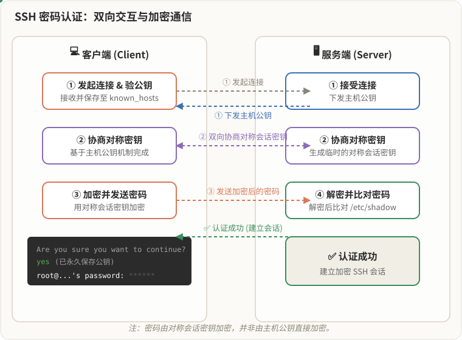
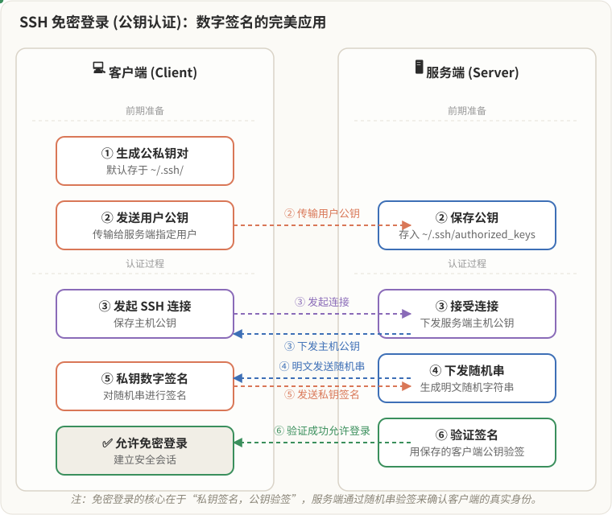
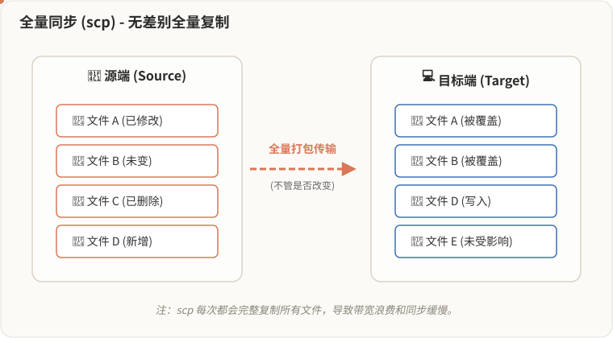
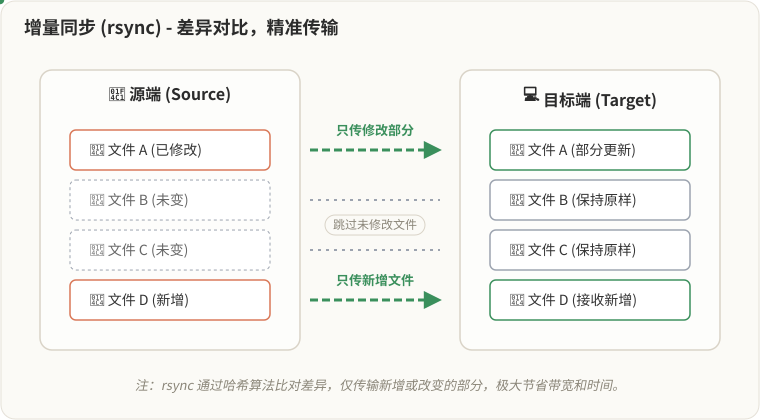

[🏠 返回本阶段首页](../../01-Linux-Cloud-Ops-Junior.md#️-本阶段主要学习内容)
>[!important]
>**网络客户端关键点**
>1. 如何在Linux系统上通过命令行下载网络上的文件
>2. 如何通过网络远程管理Linux系统 
>3. 如果无法ssh怎么进行排错，怎么让ssh更加安全的进行排错
>4. Linux系统之间如何进行文件传输，Linux系统和其他系统之间如何进行文件传输

# 1.Web客户端
## curl 

- `curl`主要作用：网页访问工具和下载工具
>[!note]
> `url`一般指的是网页地址或网址


**1. 访问网页源码**

- 指的是网页的html前端代码，返回的是网页的前端代码。例如访问www.baidu.com
```bash
curl www.baidu.com
```

返回的就是百度首页的源码
![[Pasted image 20261111211238.png]](assets/Pasted%20image%2020261111211238.png)


**2. 获取该网址的文本信息以及协议头部信息**

- 执行下列命令
```bash
curl -i <URL>
```

- 案例1：仍然以百度为例
```bash
curl -i www.baidu.com
```

返回了状态码和前端代码
![[Pasted image 20261108215749.png]](assets/Pasted%20image%2020261108215749.png)

- 案例2：访问Google
```bash
curl -i www.google.com
```

```bash
curl: (7) Failed to connect to www.google.com port 80: Connection refused
```

- 现在对这里做一个介绍
```bash
HTTP/1.1 200 OK
Cache-Control: private, no-cache, no-store, proxy-revalidate, no-transform
Content-Length: 2381
Content-Type: text/html
Pragma: no-cache
Server: bfe
Set-Cookie: BDORZ=27315; max-age=86400; domain=.baidu.com; path=/
Date: Sun, 08 Nov 2026 13:57:18 GMT
```


- HTTP状态码：根据返回的状态的不同可以判断访问是否成功
	- 200 ok：资源正常访问
	- 302：重定向
	- 401：认证失败，访问某些网站时需要登录账号和密码，如果
	- 403 Forbbiden：权限拒绝，没有权限可以访问这个资源
	- 404 资源没有找到，说明你访问的这个资源在服务端上没有
    


**3. 文件下载**

- 下载文件并命名为（filename），加上选项`-o`接上文件名和地址
```bash
curl -o filename url
```

- 案例1：保存网页内容
```bash
curl -o index.html www.baidu.com
```

```bash
  % Total    % Received % Xferd  Average Speed   Time    Time     Time  Current
                                 Dload  Upload   Total   Spent    Left  Speed
100  2381  100  2381    0     0  29395      0 --:--:-- --:--:-- --:--:-- 29762
```

![[Pasted image 20261108224642.png]](assets/Pasted%20image%2020261108224642.png)

- 案例2：下载文件 https://nginx.org/download/nginx-1.30.6.tar.gz 并保存为nginx-1.30.6.tar.gz

```bash
curl -o nginx-1.30.6.tar.gz https://nginx.org/download/nginx-1.30.6.tar.gz
```

```bash
  % Total    % Received % Xferd  Average Speed   Time    Time     Time  Current
                                 Dload  Upload   Total   Spent    Left  Speed
100 1300k  100 1300k    0     0   480k      0  0:00:02  0:00:02 --:--:--  480k
```


- 直接下载文件
```bash
curl -O url
```

```bash
curl -O https://nginx.org/download/nginx-1.30.6.tar.gz
```

>[!important]
> 与`wget`不同，即使是在最小化安装下，仍然可以


## wget 

- `wget`：专业的的Linux下载文件工具，支持HTTP，HTTPS，主要是用来下载文件的，其他用法较为少见

>[!note]
>下面介绍常见用法

- 下载文件
```bash
wget <URL>
```

例如：下载一个nginx的软件包
```bash
wget https://nginx.org/download/nginx-1.30.6.tar.gz
```

```bash
--2026-11-08 20:41:25--  https://nginx.org/download/nginx-1.30.6.tar.gz
Resolving nginx.org (nginx.org)... 3.125.197.172, 2a05:d014:5c0:2601::6, 2a05:d014:5c0:2600::6
Connecting to nginx.org (nginx.org)|3.125.197.172|:443... connected.
HTTP request sent, awaiting response... 200 OK
Length: 1331698 (1.3M) [application/octet-stream]
Saving to: ‘nginx-1.30.6.tar.gz’

nginx-1.30.6.tar.gz               100%[===========================================================>]   1.27M  30.8KB/s    in 23s

2026-11-08 20:41:49 (57.4 KB/s) - ‘nginx-1.30.6.tar.gz’ saved [1331698/1331698]
```
如果没有特别指定，默认下载路径就是当前目录下
```bash
[root@CentOS ~]# ls
anaconda-ks.cfg  Documents  initial-setup-ks.cfg  nginx-1.30.6.tar.gz  Pictures  Templates
Desktop          Downloads  Music                 Passwd               Public    Videos
```

- 后台下载文件
```bash
wget -b <file path>
```


- 指定下载目录
```bash
wget -P
```

案例：下载 https://nginx.org/download/nginx-1.30.6.tar.gz 软件包至`/data`目录
```bash
wget -P /data https://nginx.org/download/nginx-1.30.6.tar.gz 
```

![[Pasted image 20261109075822.png]](assets/Pasted%20image%2020261109075822.png)

- 下载文件后改名
```bash
wget -O <file> URL 
```

>[!warning]
>该命令工具在Linux系统最小化安装下没有配置，这个需要注意！！
  

# 2.OpenSSH

## 基本介绍

- OpenSSH(Open Security Shell)：是 SSH协议的免费开源实现。
- SSH：是一种用于远程登录网络设备和服务器的安全协议。从某种角度来说，它是一种工具，从另外一个角度上说，它也是一个工具
>[!note]
> - 两类架构
> 	- C/S架构：客户端/服务端架构，例如：游戏客户端/游戏服务端进行交互的
> 	- B/S架构：浏览器/服务端架构，例如：浏览器和服务端进行交互，现在看到的微信小程序。

- 特点
	- 对传输的所有数据（包括你的账号、密码、敲入的指令）都进行了高强度加密。即使黑客抓到数据包，也只能看到一堆乱码。
	- 默认使用22端口
	- 还支持很多扩展功能，SFTP

>[!tip]
> 在网络设备中有一种协议，叫做Telnet，这种协议最大的缺点就是**采用明文传输**，包括用户名、密码及所有交互数据均未加密。因此，在传输过程中极易被网络抓包工具（如 Wireshark）截获并直接读取，存在严重的安全隐患，现已被 SSH 协议取代。

- 默认情况下，Linux服务器都安装了`openssh-server`和`openssh-clients`，这些属于openssh套件实现的，分别对应客户端软件、服务端软件。**即使是最小化安装的情况下，也安装了客户端和服务端的openssh的软件包1**
```bash
openssh-server-8.0p1-5.el8.x86_64
openssh-clients-8.0p1-5.el8.x86_64
```

- `sshd.service`服务是默认开启，且每次开机均会自动启动
- 如果Linux开启防火墙，防火墙默认会放行ssh连接


## 基本使用

- 主要工具：`ssh` 
```bash
/usr/bin/ssh
```

**1. Linux和Linux远程连接**

- 常规的远程SSH连接，**默认连接端口是22端口**
```bash
ssh <username>@<remote host IP>/<hostname> [-p Port]
```

- 对于未连接过的主机，首先需要先保存对端主机公钥（这个内容是什么，到认证机制里面会具体介绍的），输入`yes`即保存对端主机公钥，反之则不保存
```bash
The authenticity of host '192.168.120.60 (192.168.120.60)' can't be established.
ECDSA key fingerprint is SHA256:NpyOWRyB6Ok8vHRSiqjT7uOsPsClXOql1tOB40H2L1Y.
Are you sure you want to continue connecting (yes/no/[fingerprint])? yes
Warning: Permanently added '192.168.120.60' (ECDSA) to the list of known hosts.
root@192.168.120.60's password:
Activate the web console with: systemctl enable --now cockpit.socket
```

- 第二次连接时，就不需要保存了，因为首次访问已经保存过了
```bash
[root@CentOS-Client ~]# ssh root@192.168.120.60
root@192.168.120.60's password:
```

>[!tip]
>这里提到的用主机名代替IP地址，不是随随便便就可以使用主机名，需要提前在hosts解析主机名，`/etc/hosts`

- 如果不加用户名，即按照下面的格式进行连接
```bash
ssh <remote host IP>/<hostname> [-p Port]
```

- 那么默认连接用户，是当前终端登陆的用户，
```bash
[user@CentOS-Client ~]$ ssh 192.168.120.60
The authenticity of host '192.168.120.60 (192.168.120.60)' can't be established.
ECDSA key fingerprint is SHA256:NpyOWRyB6Ok8vHRSiqjT7uOsPsClXOql1tOB40H2L1Y.
Are you sure you want to continue connecting (yes/no/[fingerprint])? yes
Warning: Permanently added '192.168.120.60' (ECDSA) to the list of known hosts.
user@192.168.120.60's password:
```


>[!important]
>- 如果用户没有设置密码，除了能从终端登录，切换用户登录之外，SSH是默认拒绝的
>- 如果用户不存在，那么找不到用户，也无法进行连接

---
- 如果要允许远程服务器上的图形界面程序，将画面（X11 协议）通过 SSH 加密隧道传回你本地，就需要加上一个参数
```bash
ssh -X <username>@<remote host IP>/<hostname> [-p Port]
```

>[!note]
>X ------>X11图形化协议，可以通过SSH来支持图形化协议转发，来打开图形化软件


- 远程执行命令，主要语法格式如下，命令部分使用引号进行引用
```bash
ssh <username>@<remote host IP>/<hostname> [-p Port] <command>
```


---
**2. windows端远程连接Linux系统**

- 从 **Windows 10 的 1809 版本**和 **Windows Server 2019** 开始，基本上Windows系统都有原生内置的SSH了，如今的Windows 11基本上都可以通过Powershell或者CMD来打开终端进行远程连接使用

- 对于没有安装OpenSSH的Windows系统，可以有下面几种处理
	- 安装openssh客户端软件，从windows版本开始已经默认安装
	- 安装支持SSH连接的工具，下面给几个常用的
		- Xshell（正版收费）
		- MobaXterm（个人使用基本免费）
		- FinalShell


## SSH认证机制

- SSH认证机制
	- 基于密码的认证
	- 基于密钥的认证（即实现免密登录）

### 对称加密与非对称加密
---

- 对称加密：加密和解密使用的是同一个钥匙（密钥）。**虽然在HTTPS中仍有使用场景，但是仍然存在风险。**
>[!warning]
> 注意：对称加密存在很大的风险
> - 对于初次远程登陆的主机，首次是需要保存对端主机公钥的，如果这里采用的是对称加密，在接下来输入密码时，本端密钥会对密码进行加密，加密后的内容会传输到远端
> - 而对于远端来说，这串字符看不懂，没有密钥来进行解密，如果要解密，就需要将原来本端的密钥传输到远端中
> - 而在这个传输过程中，密钥可能出现泄露的情况，尤其是在网络传输中，是很有可能被抓包的，一旦泄露，就可以对密码进行解密。

- 非对称加密：加密是公钥，解密时私钥，公钥和私钥可以统称为密钥

>[!important]
>SSH的两种认证都是属于非对称加密

- `/etc/ssh`目录下存放着下面的内容
	- openssh服务端的配置文件
	- openssh客户端的配置文件
	- 主机的公钥文件
	- 主机的私钥文件
```bash
ll /etc/ssh/
total 600
-rw-r--r--. 1 root root     577388 Apr 27  2020 moduli
-rw-r--r--. 1 root root       1770 Apr 27  2020 ssh_config
drwxr-xr-x. 2 root root         28 Jan 24  2026 ssh_config.d
-rw-------. 1 root root       4267 Jan 24  2026 sshd_config
-rw-r-----. 1 root ssh_keys    492 Aug 31 07:45 ssh_host_ecdsa_key
-rw-r--r--. 1 root root        162 Aug 31 07:45 ssh_host_ecdsa_key.pub
-rw-r-----. 1 root ssh_keys    387 Aug 31 07:45 ssh_host_ed25519_key
-rw-r--r--. 1 root root         82 Aug 31 07:45 ssh_host_ed25519_key.pub
-rw-r-----. 1 root ssh_keys   2578 Aug 31 07:45 ssh_host_rsa_key
-rw-r--r--. 1 root root        554 Aug 31 07:45 ssh_host_rsa_key.pub
```

- 主机的公钥和私钥文件都是成对出现的，前者用于加密，后者用于解密
```bash
ssh_host_ecdsa_key        ------> 公钥文件
ssh_host_ecdsa_key.pub    ------> 私钥文件
```


### 基于密码认证的原理
---

>[!tip]
>主动发起连接的主机被称为客户端， 被发起连接的主机称为服务端


- 客户端主动向服务端发起连接，首次连接需要接受对端主机公钥，输入`Yes`，下面警告：将永久保存到客户端主机当前用户的家目录下的`.ssh/known_hosts`文件中
```bash
The authenticity of host '192.168.120.60 (192.168.120.60)' can't be established.
ECDSA key fingerprint is SHA256:NpyOWRyB6Ok8vHRSiqjT7uOsPsClXOql1tOB40H2L1Y.
Are you sure you want to continue connecting (yes/no/[fingerprint])? yes
Warning: Permanently added '192.168.120.60' (ECDSA) to the list of known hosts.
root@192.168.120.60's password:
Activate the web console with: systemctl enable --now cockpit.socket
```


- 原理解释
	1. 客户端主动向服务端发起连接，首次连接需要接受对端主机公钥，接收后会被永久保存到客户端主机当前用户的家目录下的`.ssh/known_hosts`
	2. 双方利用刚才的主机公钥机制，安全地协商出一个临时的“**对称会话密钥**“
	3. 客户端输入对端用户的密码，并使用刚才协商好的“**对称会话密钥**“对密码进行加密，发送给服务端
	4. 服务端收到密文后，使用相同的“对称会话密钥”解密出明文密码。然后与系统内部的用户密码哈希值（如 Linux 的 `/etc/shadow`）进行比对，一致则允许登录。




### 基于密钥认证的原理
---

- 原理解释
	1. 客户端的当前用户生成一对公私钥文件（默认存放在`~/.ssh/`）
	2. 客户端将用户的公钥文件传输给对端主机的**指定用户**（用户家目录下的`.ssh/authorized_keys`）
	3. 客户端向服务端发起SSH连接，首次连接依然是保存对端连接用户的主机公钥
	4. 服务端生成一个随机字符串，将这个**明文随机串**发送给客户端。
	5. 客户端收到后，使用自己的**用户私钥**对这段随机串进行**数字签名**，并将签名后的数据发给服务端。
	6. **服务端**接收到后，使用之前保存的**客户端公钥**来**验证这个签名**。如果验证成功，说明客户端确实拥有对应的私钥，直接允许免密登录；失败则拒绝。




>[!important]
>免密登录的对象取决于客户端当前用户将用户自己的公钥文件传输给了对端的哪个用户，传给了对端哪个用户，就只能免密登录这个用户


## 配置免密登录

>[!note]
>需求：有两台主机，CentOS-Client和CentOS-Server，IP地址如下，需要Client端可以免密登录Server端
>- CentOS-Client IP：192.168.120.45
>- CentOS-Server IP：192.168.120.60


>[!tip]
>下面的所有操作都是在客户端上进行！！

**1. 在客户端生成一对用户的公钥和私钥**

- 执行下列命令
```bash
ssh-keygen
```

部分地方进行解释
- `Enter file in which to save the key (/root/.ssh/id_rsa):` **指定私钥的保存路径和文件名**，然后系统会自动在同目录下生成同名的 `.pub` 文件作为“公钥。默认是`/root/.ssh/id_rsa`，不修改就直接回车进入下一项。
- `Enter passphrase (empty for no passphrase):` 对私钥设置密码，处于安全考虑可以设置，这里用于学习，就不设置了
- `Enter same passphrase again:` 再次输入密码，上面没有设置，直接回车即可
```bash
Generating public/private rsa key pair.
Enter file in which to save the key (/root/.ssh/id_rsa):
Created directory '/root/.ssh'.
Enter passphrase (empty for no passphrase):
Enter same passphrase again:
Your identification has been saved in /root/.ssh/id_rsa.
Your public key has been saved in /root/.ssh/id_rsa.pub.
The key fingerprint is:
SHA256:Y0xCpW9eMSqOg8T/SF9zq2n3bxf/MJk0fifV0p79CYQ root@CentOS-Client.example.com
The key's randomart image is:
+---[RSA 3072]----+
|      ...        |
|     . .         |
|      o . o      |
| .     = . o.  ..|
|  o   . S .E .+ +|
| . o o = o  .o Oo|
|  . = . + .  .B.B|
|   . = ..+..  o=*|
|    . o.oo...o.o+|
+----[SHA256]-----+
```

- 完成后，可以在`~/.ssh/`目录下看到这一对公钥和私钥
```bash
[root@CentOS-Client ~]# ls .ssh/
id_rsa  id_rsa.pub
```


---
**2. 将用户公钥文件传输给服务端** 

- 执行下列命令传输用户公钥文件至服务端
```bash
ssh-copy-id root@192.168.120.60
```

>[!tip]
>如果存在多个用户公钥，如果想要指定，执行下列命令
>```bash
>ssh-copy-id -i /root/.ssh/id_rsa.pub root@192.168.120.60
>```

- 首次连接保存对端主机公钥，INFO提示可以不用管，然后输入对端主机用户密码，即传输完成。然后还提示你尝试进行远程连接
```bash
/usr/bin/ssh-copy-id: INFO: Source of key(s) to be installed: "/root/.ssh/id_rsa.pub"
The authenticity of host '192.168.120.60 (192.168.120.60)' can't be established.
ECDSA key fingerprint is SHA256:NpyOWRyB6Ok8vHRSiqjT7uOsPsClXOql1tOB40H2L1Y.
Are you sure you want to continue connecting (yes/no/[fingerprint])? yes
/usr/bin/ssh-copy-id: INFO: attempting to log in with the new key(s), to filter out any that are already installed
/usr/bin/ssh-copy-id: INFO: 1 key(s) remain to be installed -- if you are prompted now it is to install the new keys
root@192.168.120.60's password:

Number of key(s) added: 1

Now try logging into the machine, with:   "ssh 'root@192.168.120.60'"
and check to make sure that only the key(s) you wanted were added.
```


---
**3. 尝试远程连接**

（1）Linux下的免密登录
- 进行远程连接，并未要求输入密码，免密登录配置成功
```bash
ssh root@192.168.120.60
```

```bash
[root@CentOS-Client ~]# ssh root@192.168.120.60
Activate the web console with: systemctl enable --now cockpit.socket

Last login: Tue Nov 10 21:28:56 2026 from 192.168.120.45
[root@CentOS-Server ~]#
```


>[!tip]
>下面介绍一下Windows下的免密登录，这个还是经常使用的，如果不想输密码，可以用密钥的方式进行认证

（2）Windows下的登录
- 通过第三方工具进行免密登录，将私钥文件导入到桌面，或者通过SCP工具可以直接将文件拉取到Windows端
```bash
scp root@192.168.120.45:/root/.ssh/id_rsa C:\Users\30637\Desktop
```


- 这里以MobaXterm为例，登录时使用私钥进行登录
![[Pasted image 20261110220614.png]](assets/Pasted%20image%2020261110220614.png)

- 通过私钥进行认证，同样也没有要求密码认证，免密登录成功
![[Pasted image 20261110220700.png]](assets/Pasted%20image%2020261110220700.png)


>[!important]
>关于传输用户公钥，传输的对端用户取决于你想要去免密登录的用户，即**你想免密登录谁，你就将公钥文件传给谁**

---
- 为了保证私钥的安全性，对私钥文件进行加密，即使私钥文件泄露，别人拿着私钥文件登录的时候是需要验证私钥文件的密码
![[Pasted image 20261111102538.png]](assets/Pasted%20image%2020261111102538.png)

- 第一次登录需要验证私钥文件密码，后续登录因为系统存在ssh-agent的进程，所以相当于缓存了密钥文件的解密的密码，所以才不需要验证私钥密码
```bash
[root@localhost .ssh]# ps -ef |grep ssh-agent
root 3092 2045 0 14:07 ? 00:00:00 /usr/bin/ssh-agent -D -a /run/user/0/keyring/.ssh
```


## 免密登录会出现的问题

1. 如果客户端的用户私钥文件泄露，只要有用户可以读取这个私钥文件内容，则这个用户也可以使用私钥进行免密登录

>[!note]
>解决方法：建议是只给**私钥**文件赋予拥有人可读的权限，即600 `r--`，其他人都不要赋予权限


2. **私钥文件权限过大，不允许免密登录的**。系统认为这个私钥文件权限过大，不安全，所以不允许登录使用

![[Pasted image 20261110221006.png]](assets/Pasted%20image%2020261110221006.png)

>[!note]
>解决方法：将私钥文件的权限调小一点设置为600或者其他更小的权限


3. 报错提示如下，有两种可能
- 被连接的对端主机的主机公钥发生了变化。可能试主机公钥被删除后重新生成
- 被连接的IP地址存在多台主机，即多台主机的IP地址与这个IP地址一致

![[Pasted image 20261110221140.png]](assets/Pasted%20image%2020261110221140.png)

>[!tip]
> 这两种可能性究其本质，就是被连接的对端主机公钥发生了变化
> - 解决方法：删除客户端保存的服务端的主机公钥文件，即`~/.ssh/known_hosts`重新来保存才可以实现远程登录


## SSH服务配置文件

- `/etc/ssh/`目录下的配置文件
	- ssh（客户端）的配置文件目录：**`/etc/ssh`**
	- sshd（服务端）的配置文件：**`/etc/ssh/sshd_config`**
	- sshd的配置目录：`/etc/ssh/sshd_config.d`目录下

- 修改最多的配置文件
```bash
/etc/ssh/sshd_config
```

- 常见修改配置项如下

| 参数                           | 功能                                            |
| :--------------------------- | :-------------------------------------------- |
| `Port 22`                    | 默认的sshd服务端口                                   |
| `ListenAddress 0.0.0.0`      | 设定sshd服务器监听的IP地址                              |
| `PermitRootLogin yes`        | 设定是否允许root管理员直接登录<br>**(RHEL9默认不允许root远程登录)** |
| `MaxAuthTries 6`             | 最大密码尝试次数                                      |
| `MaxSessions 10`             | MaxSessions 10                                |
| `PasswordAuthentication yes` | 是否允许密码验证                                      |
| `PermitEmptyPasswords no`    | 是否允许空密码登录（很不安全）                               |
>[!important]
>注意：关于配置文件的修改后，**一定要重启sshd服务**，否则配置是不会生效的
>```bash
>systemctl restart sshd.service
>```


- sshd服务端默认开放的是22端口，但是在实际环境中不会使用22端口，由于是默认配置，通常会将端口更改为其他非常见端口，以防止被爆破连接。
- 这里如果对端口修改了，**由于防火墙默认是允许22端口流量进入的**，修改为非常规端口后，需要关闭防火墙和SELinux
```bash
#Port 22
Port 2222
#AddressFamily any
#ListenAddress 0.0.0.0
#ListenAddress ::
```

- 临时关闭防火墙和SELinux，可以永久关闭，这里先用临时关闭
```bash
systemctl stop firewalld.service
```

```bash
setenforce 0
```


# 3.跨主机传输文件

## scp

- `scp`：文件传输，`scp`=`ssh`+`cp`

>[!note]
>下面做基本使用介绍

- 推送文件到远端
```bash
scp [选项] 本机上的源文件路径 目标端用户@目标端IP地址:目标端目录
```

- 案例：推送一个文件
```bash
scp hello.txt root@192.168.120.45:/opt
```

```bash
The authenticity of host '192.168.120.45 (192.168.120.45)' can't be established.
ECDSA key fingerprint is SHA256:qOdMDoWlUFEuEFC8XvU6LuEeFeLkJlDvuwSuPO1Nnjc.
Are you sure you want to continue connecting (yes/no/[fingerprint])? yes
Warning: Permanently added '192.168.120.45' (ECDSA) to the list of known hosts.
root@192.168.120.45's password:
hello.txt                                           100%   19    10.4KB/s   00:00
```

- 从远程拉取文件
```bash
scp [选项] 目标端用户@目标端IP地址:目标端目录 本机上的源文件路径
```

- 远端拉取
```bash
scp root@192.168.120.60:/root/hw.txt /data/
```

```bash
root@192.168.120.60's password:
hw.txt                                               100%   11     0.8KB/s   00:00
```

**2. 常用选项**

- `-r`：复制目录
- `-p` ：保留时间和权限（保留属性信息）
- `-P` 指定远程主机的端口号
- `-C` 压缩数据，**这个压缩是需要CPU**


>[!warning]
>在RHEL9版本中，已经不推荐使用`scp`命令传输文件，在其他的Linux发行版本建议也不要使用`scp`命令传输，因为`scp`这个命令会有BUG,而且这个命令也不怎么安全。如果你是在企业内部局域网中传输文件，而这些文件系统的变量文件，类似`/etc/bashrc` 、`/etc/profile`...，如果存在具有输出性质的命令的时候，通过`scp`命令传输文件会失败。

- 复现一下
```bash
echo "echo huawei123" >> /etc/bashrc

[root@localhost sshd]# scp -P 2222 index.html root@192.168.68.130:/opt
root@192.168.68.130's password:
Received message too long 1752523127
Ensure the remote shell produces no output for non-interactive sessions.
```


  
## sftp

- 这个工具和ftp客户端工具使用方法一样，不过走的是SSH协议。通常情况下，我们在Linux和Linux之间使用scp或者rsync进行传输文件
- **只有windows和Linux之间通常使用这种方式传输文件，当然也是通过第三方支持sftp的工具来传输**
	- xftp工具
	- winscp工具

  

## rsync

- `rsync`工具也是依赖于SSH协议，原因在于`rsync`支持增量同步，这就是最大的一个特点，也是为什么红帽推荐的重要原因

- `rsync`和`scp`最大的`scp`属于全量同步，`rsync`属于增量同步

>[!tip]
>下面具体解释全量同步和增量同步

- 全量同步（`scp`）：每一次拷贝文件都是全部拷贝，从某种角度上说
	- 对于已经传输过的文件，进行全量同步等于是覆盖
	- 对于未传输过的文件，进行全量同步等于是写入




- 增量同步（`rsync`）：每一次拷贝文件只是拷贝新增的内容
	- 对于传输过去的文件，如果源文件修改或者新增内容，那么增量同步只会同步修改和新增的部分，其余未发生变化的部分，不会进行同步
	- 对于未传输的文件，此时进行增量同步效果上与全量同步无异




>[!tip]
>- 如果文件是第一次传输，`scp`和`rsync`没啥差别，用哪个都行
>- 如果文件内容发生变化，需要多次传输，建议使用`rsync`


- 在文件传输上二者也存在一些差别
	- `scp`传输的过程中，如果失败或者中断了，文件内容会不完整，但是对端主机仍然会有这个文件，而且传输过去后，大多通过文件内容大小来判断内容是否完整
	- `rysnc`传输，如果失败或者中断了，对端主机不会有这个文件，所以不用担心文件在传输过程中存在的不完整的问题


- `rsync`在使用上与`scp`没有什么很大的差别，只需将原有`scp`替换为`rsync`即可
```bash
rsync hello.txt root@192.168.120.45:/opt
```


- 语法格式
1. 推送文件到远端：rsync [选项] 本机上的源文件路径 目标端用户@目标端IP地址:目标端目录
```bash
rsync [OPTIONS] 本机上的源文件路径 目标端用户@目标端IP地址:目标端目录
```


2. 从远程拉取文件：
```bash
rsync [OPTIONS] 目标端用户@目标端IP地址:目标端目录 本机上的源文件路径
```


- 常用选项
    - **`-a`** ：开启归档模式，支持目录的同步，支持权限的保留
    - **`-r`** ：传输目录
    - **`-v`** ：显示传输的详细信息
    - **`-z`** ：开启压缩功能，压缩会消耗CPU资源，根据CPU实际情况选择是否开启

>[!important]
>rsync传输目录需要注意的：如果传输的是目录，目录后面带上`/` 表示传输的是目录下的所有文件，如果目录后面没有带`/`表示传输的是一整个目录。
> - 把etc目录进行传输，没有`/`。
> ```bash
> rsync -r root@192.168.68.130:/etc .
> ```
> - 把etc目录下所有文件进行传输，有`/`。
> ```bash
> rsync -r root@192.168.68.130:/etc/
> ```


- 信息以及递归传输----->三剑客：`-avz`
```bash
rsync /etc/passwd -avz root@192.168.120.60:/opt
```

```bash
sending incremental file list
passwd

sent 1,085 bytes  received 35 bytes  2,240.00 bytes/sec
total size is 2,589  speedup is 2.31
```

- --delete 以源路径为主，**对目标路径，多则删之，少则补之**
>- 谁在前谁就是源路径，目的是为了保障节点之间的文件一致性

>[!tip]
> 
> 问题：如果rhel8的file1文件和rhel9的file1文件内容不一样，会被删掉吗？
> - 更新，不是删除！！只要文件名一样，那么同步更新文件的内容

  
- --existing：忽略目标端不存在的文件，只会同步存在的文件（你有的我就同步更新，你没有我就不管）
- --ignore-existing：忽略目标端已经存在的文件，只会同步不存在的文件（你有的我不管，你没有的我就给你）


>[!note]
>实验环境如下：准备两台主机
>- A主机：IP为192.168.120.45，存在目录`/opt`，目录内容如下
>	- file1(/etc/passwd）
>	- file2(/etc/group）
>- B主机：IP为192.168.120.60，存在目录`/opt`，概念目录下没有内容

- 需求1：将A主机`/opt`目录所有的数据文件同步到B主机的`/opt`目录下，要求如下，必须保证俩边目录下的文件一致，如果B主机多了文件则自动删除
```bash
rsync -avz --delete /opt/ root@192.168.120.60:/opt
```

- 需求2：将A主机`/opt`目录下的文件同步给B主机的`/opt`目录，只同步不存在的文件，如果文件存在则不同步
```bash
rsync -avz --ignore-existing /opt/ root@192.168.120.60:/opt
```

>[!]