[🏠 返回本阶段首页](../../01-Linux-Cloud-Ops-Junior.md#️-本阶段主要学习内容) / [🗄️ 返回存储管理](../Indexes/07-存储管理.md)

# 磁盘分区

## 分区概念与分区方案

- 分区：对一个物理存储空间划分多个相互独立的逻辑存储空间。
	- 所谓独立就是两个逻辑存储区域之间互补干扰，互相隔离

>[!tip]
>在进行分区的时候，必须选择一种分区方案，如果不选择，会按照默认选项进行选择

- 分区方案主要有两种类型
	- MBR
	- GPT：现在基本上都是这种分区方案，电脑上和大多数服务器上都是使用的这个

>[!note]
>下面分别进行介绍

---
**1.MBR**

- MBR分区分为三种分区类型
	- 主分区
	- 扩展分区
	- 逻辑分区
- 对于MBR分区方案有以下限制
1. 最多只能划分4个主分区，划分完就不能继续划分了
![[MBR_Four-Primary.svg|700]](assets/MBR_Four-Primary.svg)


2. 最多可以划分3个主分区+1个扩展分区（+N个逻辑分区）
![[MBR_Three Primary and one extended.svg|700]](assets/MBR_Three%20Primary%20and%20one%20extended.svg)

>[!tip]
>这里说的逻辑分区，是从扩展分区中划分的

- **对于MBR分区方案，如果磁盘已经划分了3个主分区，剩下的磁盘空间一定要全部给扩展分区**。如果只把剩下磁盘空间的部分给了扩展分区，那么未分区的部分就再也无法使用了，尤其是划分扩展分区很小的时候，会极大地造成空间的浪费

![[MBR_suggestion.svg|700]](assets/MBR_suggestion.svg)


>[!important]
> 对于MBR分区方案来说，被GPT淘汰主要是因为
> - 没有备份
> - 单个分区大小不能超过2TB


- 对于MBR分区方案来，磁盘的前512字节是主引导记录，内部划分如下
	- 前446字节：引导代码，负责引导操作系统
	- 第447~510字节：分区表，这里真正记录着
		- 磁盘有多少个分区
		- 每个分区的大小
	- 最后字节：结束标志

- 例如有如下磁盘信息
```bash
sdb      8:16   0    1G  0 disk
├─sdb1   8:17   0  100M  0 part
├─sdb2   8:18   0  100M  0 part
└─sdb3   8:19   0  823M  0 part
```

- 通过零字符设备对该`/dev/sdb`设备的前512字节填充掉，那么这个分区就没有了
```bash
dd if=/dev/zero of=/dev/sdb bs=512 count=1
```

![[Clear_Partion.svg|700]](assets/Clear_Partion.svg)

---
**2.GPT**

- GPT分区方案：理论上是没有分区数量上限的，但实际上上限是128个分区
>[!note]
>默认分区表只会预留128分区条目空间


- GPT分区方案特点
	- GPT没有分区类型，所有的分区都可以是主分区
	- 单个分区大小可以超过2TB，理论上最大9.44ZB，在Windows下上限为18EB
	- GPT的头部和尾部都具备分区表信息，即使把头部的信息删掉了，也可以通过尾部来进行回复，这也是实现备份的方式

>[!tip]
>当磁盘不支持GPT分区方案的时候才使用MBR分区方案，例如系统启动方式不一致，也会导致分区方案不一致
>- BIOS：与MBR分区方案绑定
>- UEFI：与GPT分区方案绑定


## 分区工具

- 主要介绍三种分区工具
	- `parted`
	- `fdisk`
	- `gdisk`
- 为了进行下面的演示，此处需在虚拟机上一块新的磁盘，具体添加方式请看[磁盘添加及问题](./磁盘添加及问题.md)

### parted
---
- `parted`工具：支持交互式和非交互式对磁盘进行分区，交互式的每一次操作完成，一回车就保存了分区信息

**1. 交互式**

- 主要命令格式
```bash
parted /dev/sda
```

```bash
GNU Parted 3.2
Using /dev/sda
Welcome to GNU Parted! Type 'help' to view a list of commands.
(parted)
```

- 通过输入`help`获取帮助，部分展示，不过多介绍，下面只介绍核心操作
```bash
(parted) help
  align-check TYPE N                        check partition N for TYPE(min|opt) alignment
  help [COMMAND]                           print general help, or help on COMMAND
  mklabel,mktable LABEL-TYPE               create a new disklabel (partition table)
  mkpart PART-TYPE [FS-TYPE] START END     make a partition
  name NUMBER NAME                         name partition NUMBER as NAME
  print [devices|free|list,all|NUMBER]     display the partition table, available  
  quit                                     exit program
 END
  resizepart NUMBER END                    resize partition NUMBER
  rm NUMBER                                delete partition NUMBER
  select DEVICE                            choose the device to edit
  disk_set FLAG STATE                      change the FLAG on selected device
  set NUMBER FLAG STATE                    change the FLAG on partition NUMBER
  toggle [NUMBER [FLAG]]                   toggle the state of FLAG on partition NUMBER
  unit UNIT                                set the default unit to UNIT
  version                                  display the version number and copyright information of GNU Parted
```


- 选择分区方案：对新的磁盘划分时一定要指定，这里的分区方案只需要关注`gpt`和`msdos`，`msdos`就是MBR分区方案
```bash
(parted) mklabel
New disk label type?
aix    amiga  atari  bsd    dvh    gpt    loop   mac    msdos  pc98   sun
```


- 分区
	- 选择分区类型：主分区还是扩展分区
	- 分区在磁盘的起始位置
```bash
(parted) mkpart
Partition type?  primary/extended? primary
File system type?  [ext2]? ---->这个文件系统类型只是一个标识，并不是实际的类型，填啥都可以，默认是ext2
affs0            affs6            amufs3           btrfs            hfs            
affs1            affs7            amufs4           ext2             hfs+      
affs2            amufs            amufs5           ext3             hfsx          
affs3            amufs0           apfs1            ext4             hp-ufs         
affs5            amufs2           asfs             fat32            linux-swap     
File system type?  [ext2]? xfs
Start? 1MiB
End? 1024MiB
```

>[!important]
>这里填入的分区在磁盘上的起始位置的单位有些区别，如果都是从1开始，到1024结束
>- 如果单位是M，分区大小根本够不上1024M，里面看的是虚假的信息
> ```bash
> (parted) mkpart
Partition type?  primary/extended? primary
File system type?  [ext2]?
Start? 1M
End? 1024M
(parted) print
Model: VMware, VMware Virtual S (scsi)
Disk /dev/sda: 21.5GB
Sector size (logical/physical): 512B/512B
Partition Table: msdos
Disk Flags:
Number  Start   End     Size    Type     File system  Flags
 1      1049kB  1024MB  1023MB  primary  ext2         lba
> ```
> 另开终端查看实际远远缩水
> ```bash
> [root@CentOS ~]# lsblk
NAME        MAJ:MIN RM  SIZE RO TYPE MOUNTPOINT
sda           8:0    0   20G  0 disk
└─sda1        8:1    0  976M  0 part
> ```
>- 如果单位是MiB，分区大小正好是1024M


- 由于是实时生效的，可以再另开一个终端，查看下分区信息，也可以在`parted`内部查看
```bash
[root@CentOS ~]# lsblk
NAME        MAJ:MIN RM  SIZE RO TYPE MOUNTPOINT
sda           8:0    0   20G  0 disk
└─sda1        8:1    0 1023M  0 part
sr0          11:0    1  9.3G  0 rom
nvme0n1     259:0    0  100G  0 disk
├─nvme0n1p1 259:1    0    1G  0 part /boot
└─nvme0n1p2 259:2    0   99G  0 part
  ├─cl-root 253:0    0 63.9G  0 lvm  /
  ├─cl-swap 253:1    0    4G  0 lvm  [SWAP]
  └─cl-home 253:2    0 31.2G  0 lvm  /home

```

`parted`内部查看
```bash
(parted) print
Model: VMware, VMware Virtual S (scsi)
Disk /dev/sda: 21.5GB
Sector size (logical/physical): 512B/512B
Partition Table: msdos
Disk Flags:

Number  Start   End     Size    Type     File system  Flags
 1      1049kB  1074MB  1073MB  primary  xfs          lba
```

- 删除分区
```bash
(parted) rm 1
(parted) print
Model: VMware, VMware Virtual S (scsi)
Disk /dev/sda: 21.5GB
Sector size (logical/physical): 512B/512B
Partition Table: msdos
Disk Flags:

Number  Start  End  Size  Type  File system  Flags
```


- 退出，退出时会有信息提示，可以忽略，这里提示的是永久挂载的一个文件`/etc/fstab`，提示更新它
```bash
(parted) quit
Information: You may need to update /etc/fstab.
```


**2. 非交互式**

- 直接执行命令即可，本质是将交互式的输入转化为命令
```bash
parted /dev/sdb mklabel msdos mkpart primary xfs 1MiB 1024MiB
```

>[!warning]
>这里依然要注意，对于已经指定过分区方案的磁盘，再次指定会出现问题，报错如下，即使最后输入Yes也无法创建该分区

```bash
Warning: The existing disk label on /dev/sdb will be destroyed and all data on this disk willbe lost. Do you want to continue?
Yes/No? Yes                                                               
Information: You may need to update /etc/fstab.
```

- 所以实际命令是下面的
```bash
parted /dev/sdb  mkpart primary xfs 1MiB 1024MiB
```

- 这里的xfs与交互式中一样，依然是标识，没有任何作用，所以仍然可以去掉，默认是ext2，最终简化成如下命令
```bash
parted /dev/sdb  mkpart primary 1MiB 1024MiB
```


### fdisk
---
- `fdisk`工具：只支持交互式对磁盘进行分区
	- `fdisk`原来支持MBR，现在支持MBR+GPT

>[!tip]
>主要掌握这个工具

- 查看所有磁盘信息
```bash
fdisk -l
```

第一块磁盘信息，如下，显示磁盘大小，磁盘分区信息
```bash
Disk /dev/nvme0n1: 100 GiB, 107374182400 bytes, 209715200 sectors
Units: sectors of 1 * 512 = 512 bytes
Sector size (logical/physical): 512 bytes / 512 bytes
I/O size (minimum/optimal): 512 bytes / 512 bytes
Disklabel type: dos   # 分区方案为MBR
Disk identifier: 0x238e4c1b

Device         Boot   Start       End   Sectors Size Id Type # 这个类型也只是一个标识
/dev/nvme0n1p1 *       2048   2099199   2097152   1G 83 Linux 
/dev/nvme0n1p2      2099200 209715199 207616000  99G 8e Linux LVM
# Boot这里标注有*的，表示是系统的启动引导分区，即Boot分区

Disk /dev/mapper/cl-root: 63.9 GiB, 68585259008 bytes, 133955584 sectors
Units: sectors of 1 * 512 = 512 bytes
Sector size (logical/physical): 512 bytes / 512 bytes
I/O size (minimum/optimal): 512 bytes / 512 bytes


Disk /dev/mapper/cl-swap: 4 GiB, 4227858432 bytes, 8257536 sectors
Units: sectors of 1 * 512 = 512 bytes
Sector size (logical/physical): 512 bytes / 512 bytes
I/O size (minimum/optimal): 512 bytes / 512 bytes


Disk /dev/mapper/cl-home: 31.2 GiB, 33483128832 bytes, 65396736 sectors
Units: sectors of 1 * 512 = 512 bytes
Sector size (logical/physical): 512 bytes / 512 bytes
I/O size (minimum/optimal): 512 bytes / 512 bytes

```

第二块磁盘信息
```bash
Disk /dev/sda: 20 GiB, 21474836480 bytes, 41943040 sectors
Units: sectors of 1 * 512 = 512 bytes
Sector size (logical/physical): 512 bytes / 512 bytes
I/O size (minimum/optimal): 512 bytes / 512 bytes
Disklabel type: dos
Disk identifier: 0xb20bde4d

```

- 如果想指定具体磁盘，在命令后接上对应磁盘即可
```bash
fdisk -l /dev/sda
```

```bash
Disk /dev/sda: 20 GiB, 21474836480 bytes, 41943040 sectors
Units: sectors of 1 * 512 = 512 bytes
Sector size (logical/physical): 512 bytes / 512 bytes
I/O size (minimum/optimal): 512 bytes / 512 bytes
Disklabel type: dos
Disk identifier: 0xb20bde4d
```


---
- 这里将磁盘分区信息全部清空，包括分区方案
```bash
[root@CentOS ~]# dd if=/dev/zero of=/dev/sda bs=512 count=1
1+0 records in
1+0 records out
512 bytes copied, 0.000875673 s, 585 kB/s
[root@CentOS ~]# fdisk -l /dev/sda
Disk /dev/sda: 20 GiB, 21474836480 bytes, 41943040 sectors
Units: sectors of 1 * 512 = 512 bytes
Sector size (logical/physical): 512 bytes / 512 bytes
I/O size (minimum/optimal): 512 bytes / 512 bytes
```
---

- `fdisk`是一个交互式分区工具，直接在命令后接上磁盘名即可
```bash
fdisk /dev/sda
```

进入交互式界面，按下`m`提供帮助。信息提示说明：所有改变只是在内存中，直到你决定将其保存
```bash
Welcome to fdisk (util-linux 2.32.1).
Changes will remain in memory only, until you decide to write them.
Be careful before using the write command.

Device does not contain a recognized partition table.
Created a new DOS disklabel with disk identifier 0xbae0ab14.  
# 默认进来就会指定这个磁盘的分区方案为MBR分区方案

Command (m for help):
```

- 使用较多的主要有下面几个
	- `d   delete a partition`：删除指定分区
	- `n   add a new partition`：创建分区
	- `p   print the partition table`：打印分区表信息
	- `w   write table to disk and exit`：保存操作并且退出
	- `q   quit without saving changes`：不保存操作直接退出
	- `g   create a new empty GPT partition table`：创建新的GPT分区方案
	- `o   create a new empty DOS partition table`：创建新的MBR分区方案

>[!tip]
>下面对磁盘进行分区

- 按`n`，创建分区，依次填入如下信息
	- 选择分区类型，默认是主分区，可以输入`p`，**也可以直接回车**
		- `p`：主分区，后面还显示了分区状态，0个主分区，0个扩展分区，还可创建4个主分区
		- `e`：扩展分区
	- 分区号：默认是1，可以输入1，**也可以直接回车即可**
	- 起始扇区：所有分区下，这里直接回车即可，不用写
	- 结束扇区：格式是`+<number>{K,M,G,T,P}`，后面是单位，可以理解为这里填入的就是实际分区的大小

```bash
Command (m for help): n
Partition type
   p   primary (0 primary, 0 extended, 4 free)
   e   extended (container for logical partitions)
Select (default p):

Using default response p.
Partition number (1-4, default 1):
First sector (2048-41943039, default 2048):
Last sector, +sectors or +size{K,M,G,T,P} (2048-41943039, default 41943039): +1G

Created a new partition 1 of type 'Linux' and of size 1 GiB.
```

- 打印分区信息，这里还没有保存，所以另开终端是看不到分区信息的
```bash
Command (m for help): p
Disk /dev/sda: 20 GiB, 21474836480 bytes, 41943040 sectors
Units: sectors of 1 * 512 = 512 bytes
Sector size (logical/physical): 512 bytes / 512 bytes
I/O size (minimum/optimal): 512 bytes / 512 bytes
Disklabel type: dos
Disk identifier: 0xbae0ab14

Device     Boot Start     End Sectors Size Id Type
/dev/sda1        2048 2099199 2097152   1G 83 Linux
```

- 保存并且退出，提示正在更新磁盘分区信息
```bash
Command (m for help): w
The partition table has been altered.
Calling ioctl() to re-read partition table.
Syncing disks.
```

- 查看分区
```bash
[root@CentOS ~]# lsblk
NAME        MAJ:MIN RM  SIZE RO TYPE MOUNTPOINT
sda           8:0    0   20G  0 disk
└─sda1        8:1    0    1G  0 part
```

- 删除分区，选择的分区默认是当前的最后一个分区
```bash
Command (m for help): d
Selected partition 1
Partition 1 has been deleted.

Command (m for help): p
Disk /dev/sda: 20 GiB, 21474836480 bytes, 41943040 sectors
Units: sectors of 1 * 512 = 512 bytes
Sector size (logical/physical): 512 bytes / 512 bytes
I/O size (minimum/optimal): 512 bytes / 512 bytes
Disklabel type: dos
Disk identifier: 0xbae0ab14
```


- 修改分区类型，即分区标识，当前分区信息如下
```bash
Command (m for help): p
Disk /dev/sda: 20 GiB, 21474836480 bytes, 41943040 sectors
Units: sectors of 1 * 512 = 512 bytes
Sector size (logical/physical): 512 bytes / 512 bytes
I/O size (minimum/optimal): 512 bytes / 512 bytes
Disklabel type: dos
Disk identifier: 0xbae0ab14

Device     Boot Start      End  Sectors Size Id Type
/dev/sda1        2048 10487807 10485760   5G 83 Linux

```

- 按`t`，选择分区，然后列出所有的类型，按下大写`L`
```bash
Command (m for help): t
Selected partition 1
Hex code (type L to list all codes): L

 0  Empty           24  NEC DOS         81  Minix / old Lin bf  Solaris
 1  FAT12           27  Hidden NTFS Win 82  Linux swap / So c1  DRDOS/sec (FAT-
 2  XENIX root      39  Plan 9          83  Linux           c4  DRDOS/sec (FAT-
 3  XENIX usr       3c  PartitionMagic  84  OS/2 hidden or  c6  DRDOS/sec (FAT-
 4  FAT16 <32M      40  Venix 80286     85  Linux extended  c7  Syrinx
 5  Extended        41  PPC PReP Boot   86  NTFS volume set da  Non-FS data
 6  FAT16           42  SFS             87  NTFS volume set db  CP/M / CTOS / .
 7  HPFS/NTFS/exFAT 4d  QNX4.x          88  Linux plaintext de  Dell Utility
 8  AIX             4e  QNX4.x 2nd part 8e  Linux LVM       df  BootIt
 9  AIX bootable    4f  QNX4.x 3rd part 93  Amoeba          e1  DOS access
 a  OS/2 Boot Manag 50  OnTrack DM      94  Amoeba BBT      e3  DOS R/O
 b  W95 FAT32       51  OnTrack DM6 Aux 9f  BSD/OS          e4  SpeedStor
 c  W95 FAT32 (LBA) 52  CP/M            a0  IBM Thinkpad hi ea  Rufus alignment
 e  W95 FAT16 (LBA) 53  OnTrack DM6 Aux a5  FreeBSD         eb  BeOS fs
 f  W95 Ext'd (LBA) 54  OnTrackDM6      a6  OpenBSD         ee  GPT
10  OPUS            55  EZ-Drive        a7  NeXTSTEP        ef  EFI (FAT-12/16/
11  Hidden FAT12    56  Golden Bow      a8  Darwin UFS      f0  Linux/PA-RISC b
12  Compaq diagnost 5c  Priam Edisk     a9  NetBSD          f1  SpeedStor
14  Hidden FAT16 <3 61  SpeedStor       ab  Darwin boot     f4  SpeedStor
16  Hidden FAT16    63  GNU HURD or Sys af  HFS / HFS+      f2  DOS secondary
17  Hidden HPFS/NTF 64  Novell Netware  b7  BSDI fs         fb  VMware VMFS
18  AST SmartSleep  65  Novell Netware  b8  BSDI swap       fc  VMware VMKCORE
1b  Hidden W95 FAT3 70  DiskSecure Mult bb  Boot Wizard hid fd  Linux raid auto
1c  Hidden W95 FAT3 75  PC/IX           bc  Acronis FAT32 L fe  LANstep
1e  Hidden W95 FAT1 80  Old Minix       be  Solaris boot    ff  BBT
```

修改成功
```bash
Hex code (type L to list all codes): 8e
Changed type of partition 'Linux' to 'Linux LVM'.

Command (m for help): p
Disk /dev/sda: 20 GiB, 21474836480 bytes, 41943040 sectors
Units: sectors of 1 * 512 = 512 bytes
Sector size (logical/physical): 512 bytes / 512 bytes
I/O size (minimum/optimal): 512 bytes / 512 bytes
Disklabel type: dos
Disk identifier: 0xbae0ab14

Device     Boot Start      End  Sectors Size Id Type
/dev/sda1        2048 10487807 10485760   5G 8e Linux LVM
```


### gdisk
---
- `gdisk`工具：支持交互式，需要保存才可以生效
- 这个工具不过多介绍，和`fdisk`工具非常类似，对于未选择分区方案的磁盘来说，使用`gdisk`工具默认选择GPT分区方案
```bash
[root@CentOS ~]# gdisk /dev/sda
GPT fdisk (gdisk) version 1.0.3

Partition table scan:
  MBR: not present
  BSD: not present
  APM: not present
  GPT: not present

Creating new GPT entries.

Command (? for help):
```

- 对于剩下的分区操作，与`fdisk`使用上几乎无异，只是输入命令可能有些许差别，通过`?`自行查询帮助使用即可。

## 分区问题

* 使用分区工具对磁盘划分分区，发现保存之后，没有看到这个分区。可能会有如下提示信息
```bash
The kernel still uses the old partitions. The new table will be used at the next reboot.

Syncing disks.
```

- 信息提示：内核读取的还是旧的分区表，需要告诉内核去更新一下，方式有两种
	- 重启
	- 使用命令：`partprobe`，该命令会直接刷新所有磁盘的分区表信息，让内核读取最新的分区表信息
	- `partx + device` 同上作用 


# 磁盘格式化

- 上面对磁盘进行了分区，接下来就要对磁盘进行格式化

## 基本概念

- 格式化：对分区或者对整块硬盘创建文件系统。**新的文件系统会覆盖旧的元数据（例如文件索引）**，inode这类索引被清空后，操作系统无法再找到，所以说格式化等同于清空数据。
	- 文件系统就是文件存储的方式和组织结构，记住文件系统是存储文件的，文件系统是在分区或者硬盘上创建的，有了文件系统才可以存储文件

- 目前在Linux系统中，主流的文件系统有下面两种
	- ext4：适合于小文件场景
	- xfs：适合于大文件场景，更消耗CPU资源


## 格式化

- 核心命令：`mkfs`
>[!tip]
>主要有两种方式对磁盘分区进行格式化

- 方式1
```bash
mkfs -t [System Type] <Device Path>
```

例如对`/dev/sda1`使用ext4文件系统进行格式化
```bash
mkfs -t ext4 /dev/sda1
```

```bash
mke2fs 1.45.6 (20-Mar-2020)
Creating filesystem with 1310720 4k blocks and 327680 inodes
Filesystem UUID: 023e4e28-287b-4ad5-80c4-ff8b8f141f45
Superblock backups stored on blocks:
        32768, 98304, 163840, 229376, 294912, 819200, 884736

Allocating group tables: done
Writing inode tables: done
Creating journal (16384 blocks): done
Writing superblocks and filesystem accounting information: done
```

- 方式2
```bash
mkfs.[System Type] <Device Path>
```

```bash
mkfs.xfs /dev/sda2
```

```bash
meta-data=/dev/sda2              isize=512    agcount=4, agsize=196608 blks
         =                       sectsz=512   attr=2, projid32bit=1
         =                       crc=1        finobt=1, sparse=1, rmapbt=0
         =                       reflink=1
data     =                       bsize=4096   blocks=786432, imaxpct=25
         =                       sunit=0      swidth=0 blks
naming   =version 2              bsize=4096   ascii-ci=0, ftype=1
log      =internal log           bsize=4096   blocks=2560, version=2
         =                       sectsz=512   sunit=0 blks, lazy-count=1
realtime =none                   extsz=4096   blocks=0, rtextents=0
```

- 对于大文件的场景，可以通过`-b`来指定block块的大小


>[!caution]
>对于目前在虚拟机上演示的磁盘，由于磁盘分区大小很小（相较于实际工作场景中），所以格式化的时间很快，但是实际场景进行格式化的磁盘大多都会到TB级别，所以时间相应的会很长，执行格式化的过程中，千万不要强行中断，否则可能会导致磁盘损坏！


## 查看文件系统

- 通过下面的命令来查看文件系统类型以及UUID
```bash
blkid
```

- 可以看到`/dev/sda1`与`/dev/sda2`分别被格式化为了ext4和xfs的文件系统
	- 最前面是设备路径
	- UUID:设备的全局唯一标识符，可以理解为块设备的身份证号
	- PPTYPE：分区表类型，dos代表是MBR分区方案，gpt代表是GPT分区方案
	- BLOCK_SIZE：设备的Block块的大小
```bash
/dev/nvme0n1: PTUUID="238e4c1b" PTTYPE="dos"
/dev/nvme0n1p1: UUID="5ea622d3-ec88-4bbf-9cb3-068e353e4db6" BLOCK_SIZE="512" TYPE="xfs" PARTUUID="238e4c1b-01"
/dev/nvme0n1p2: UUID="9fFsRE-L3Se-j0EE-nOBi-w9QH-p0KB-OUIgT2" TYPE="LVM2_member" PARTUUID="238e4c1b-02"
/dev/sr0: BLOCK_SIZE="2048" UUID="2021-06-01-20-39-18-00" LABEL="CentOS-8-4-2105-x86_64-dvd" TYPE="iso9660" PTUUID="44956b46" PTTYPE="dos"
/dev/mapper/cl-root: UUID="d6b45460-9f7d-4435-9be7-75104772410b" BLOCK_SIZE="512" TYPE="xfs"
/dev/mapper/cl-swap: UUID="30932a8b-aea8-48fa-ba54-5e4dda919cd7" TYPE="swap"
/dev/mapper/cl-home: UUID="87c46ef8-b88b-4f15-a899-c0fed59cb900" BLOCK_SIZE="512" TYPE="xfs"
/dev/sda1: UUID="023e4e28-287b-4ad5-80c4-ff8b8f141f45" BLOCK_SIZE="4096" TYPE="ext4" PARTUUID="8e7b1bff-01"
/dev/sda2: UUID="4cd312ef-485a-4d96-9c38-aa2e239bd961" BLOCK_SIZE="512" TYPE="xfs" PARTUUID="8e7b1bff-02"
```


# 文件系统挂载与卸载

>[!important]
>在Linux系统中，文件系统必须被挂载后才能使用

## 基本概念

- 基本概念
	- 挂载（Mount）：将独立的文件系统关联到操作系统现有目录树中的过程，即将文件系统关联到目录
	- 挂载点（Mountpoint）：挂载点就是访问文件系统的入口，挂载点大多数情况只能是目录
	- 卸载（Umount）：即将文件系统断开关联到目录

- 关于挂载点，这里还有几点说明
	- 挂载点不需要必须是空目录，有数据的目录也可以挂载。而且，挂载操作本身绝对不会清空挂载点原有的数据。
	- **但是建议将挂载点设置为空目录，即将文件系统挂载到一个没有数据的目录上**

>[!tip]
> 如果将一个文件系统挂载到一个非空目录，会存在下面的隐患
> - 数据丢失和空间浪费
> 	- 挂载点原有的数据被挂载的文件系统所遮蔽，如果遗忘了这一点，很可能就认为文件丢失了
> 	- 在清理磁盘时，找不到在哪里清理，因为看不到被遮蔽的底层数据
> - 系统服务崩溃
> 	- 如果将文件系统挂载到有某个服务的核心配置文件的目录下或者是日志文件所在目录下，那么系统运行服务找不到原有配置文件，会直接报错或者宕机

## 挂载与卸载

- 挂载目录，主要格式是`mount <device> <directory>`
```bash
mount /dev/sda1 /data/
```

- 查看挂载情况以及文件系统类型，使用下面这条命令
```bash
df -Th
```

```bash
Filesystem          Type      Size  Used Avail Use% Mounted on
devtmpfs            devtmpfs  1.9G     0  1.9G   0% /dev
tmpfs               tmpfs     2.0G     0  2.0G   0% /dev/shm
tmpfs               tmpfs     2.0G   18M  1.9G   1% /run
tmpfs               tmpfs     2.0G     0  2.0G   0% /sys/fs/cgroup
/dev/mapper/cl-root xfs        64G  6.0G   58G  10% /
/dev/mapper/cl-home xfs        32G  255M   31G   1% /home
/dev/nvme0n1p1      xfs      1014M  225M  790M  23% /boot
tmpfs               tmpfs     391M  1.2M  390M   1% /run/user/42
tmpfs               tmpfs     391M     0  391M   0% /run/user/0
/dev/sda1           ext4      4.9G   20M  4.6G   1% /data
```

>[!important]
> 格式化后，对文件系统挂载时发现，实际的大小比原先划分的大小要小，这是因为会预留一部分空间防止将分区数据写满后出现问题

- 卸载目录
```bash
uount /dev/sda1 /data/
```

卸载目录需要注意，不能处于该目录下，否则会提示如下信息
```bash
[root@node1 data]# umount /data 
umount: /data: target is busy.
```

- 挂载点作为设备的访问入口，卸载目录后，再次访问挂载点是无法访问到的，但是实际的文件仍然在底层的设备中


- 在挂载的情况下，所有的数据，都是写入到磁盘分区中
	- 包括写入到磁盘分区中的文件
	- 修改的挂载点的权限信息
- 但是一旦卸载磁盘后，原有的信息都会被随之“卸载”去掉
	- 原有的挂载点权限信息去掉了
	- 挂载时写入的文件数据，也不见了


## 永久挂载

### 文件解释
---

- 刚才的挂载操作，只是临时的，一旦重启，就会失效，但是对于磁盘分区使用来说，总不能每一次使用还要再挂载一次，会很麻烦，所以可以对其进行永久挂载
- 核心文件：`/etc/fstab`
```bash
vim /etc/fstab
```

- 文件内容如下，文件格式从左至右依次是
	- **第一个字段**：设备名，这里用`/dev/sda1`或者设备的UUID也可以，UUID用`blkid`来查看，为了防止设备的混乱出现冲突，建议使用UUID
	- **第二个字段**：挂载点
	- **第三个字段**：文件系统类型
	- **第四个字段**：挂载选项
	- **第五个字段**：dump备份标志，这个在如今的Linux版本中，已经没有什么作用了，因为很少使用，所以默认是0，过去的Linux中，0代表全备，1代表差异备份
	- **第六个字段**：fsck(filesystem check) 磁盘检查顺序，也可以说是文件系统检查
```bash
/dev/mapper/cl-root     /                       xfs     defaults        0 0
UUID=5ea622d3-ec88-4bbf-9cb3-068e353e4db6 /boot xfs     defaults        0 0
/dev/mapper/cl-home     /home                   xfs     defaults        0 0
/dev/mapper/cl-swap     none                    swap    defaults        0 0
```

**1. 挂载选项**

- 挂载选项具体说一说，下面这一条是刚才所执行的命令
```bash
mount /dev/sda1 /data
```

它等同于执行下面这个命令
```bash
mount -t ext4 -o defaults /dev/sda1 /data
```

- 而`defaults`有等于下面的这些参数
```bash
rw, suid, dev, exec, auto, nouser, and async.
```

相对应反面参数如下，而实际就需要添加这些参数
```bash
ro,nosuid,nodev,noexec,noauto,user,sync
```

| 参数名 (正面)     | 含义与作用 (正面)                      | 对立参数 (反面)    | 含义与作用 (反面)                        |
| :----------- | :------------------------------ | :----------- | :-------------------------------- |
| **`rw`**     | **读写**：允许对文件系统进行读取和写入。          | **`ro`**     | **只读**：只能读取，禁止任何修改。               |
| **`suid`**   | **允许特殊权限**：允许 SUID/SGID 位生效。    | **`nosuid`** | **禁止特殊权限**：忽略 SUID/SGID 位，防止提权攻击。 |
| **`dev`**    | **解析设备文件**：允许解析字符/块设备文件。        | **`nodev`**  | **禁止设备文件**：防止通过伪造硬件设备入侵。          |
| **`exec`**   | **允许执行**：允许直接运行该分区上的程序。         | **`noexec`** | **禁止执行**：不允许运行该分区上的任何程序。          |
| **`auto`**   | **自动挂载**：开机执行 `mount -a` 时自动挂载。 | **`noauto`** | **不自动挂载**：开机不挂载，需手动执行。            |
| **`nouser`** | **仅限 root**：只有超级管理员才能挂载。        | **`user`**   | **允许普通用户**：允许普通用户挂载。              |
| **`async`**  | **异步 I/O**：数据先写缓存，后写入磁盘（性能好）。   | **`sync`**   | **同步 I/O**：数据必须立刻写入磁盘（安全但慢）。      |

>[!tip]
>下面介绍两个参数：`ro`,`noexec`

| 挂载目标/场景           | 推荐参数组合                            | 原因与说明                                              |
| :---------------- | :-------------------------------- | :------------------------------------------------- |
| **系统根分区 (`/`)**   | `defaults`                        | 等价于 `rw,suid,dev,exec,auto,nouser,async`，满足系统基础运行。 |
| **普通数据盘**         | `defaults,noexec`                 | 防止有人把木马或脚本传到数据盘里执行。                                |
| **临时目录 (`/tmp`)** | `defaults,nosuid,nodev,noexec`    | 极高安全级别，防止恶意脚本执行、提权或挂载伪造设备。                         |
| **U 盘 / 移动硬盘**    | `defaults,noauto` 或 `user,noauto` | 设为 `noauto` 防止没插盘导致开机卡死；`user` 允许普通用户挂载。           |


（1）只读模式

- 修改`/etc/fstab`对应的参数
```bash
vim /etc/fstab
```

```bash
/dev/sda1               /data                   ext4    defaults,ro        0 0
```

- 卸载该文件系统
```bash
umount /data
```

- 执行如下命令检查是否正确
```bash
mount -a
```

查看挂载情况
```bash
[root@CentOS ~]# df -Th
Filesystem          Type      Size  Used Avail Use% Mounted on
devtmpfs            devtmpfs  1.9G     0  1.9G   0% /dev
tmpfs               tmpfs     2.0G     0  2.0G   0% /dev/shm
tmpfs               tmpfs     2.0G   18M  1.9G   1% /run
tmpfs               tmpfs     2.0G     0  2.0G   0% /sys/fs/cgroup
/dev/mapper/cl-root xfs        64G  6.0G   58G  10% /
/dev/mapper/cl-home xfs        32G  255M   31G   1% /home
/dev/nvme0n1p1      xfs      1014M  225M  790M  23% /boot
tmpfs               tmpfs     391M  1.2M  390M   1% /run/user/42
tmpfs               tmpfs     391M     0  391M   0% /run/user/0
/dev/sda1           ext4      4.9G   21M  4.6G   1% /data
```

- 尝试进入挂载点写数据，显示只读，这在光盘挂载中也是常见的，只读无法写入
```bash
[root@CentOS ~]# cd /data/
[root@CentOS data]# ls
group  gshadow  lost+found  passwd  shadow
[root@CentOS data]# rm -rf passwd
rm: cannot remove 'passwd': Read-only file system
[root@CentOS data]# touch aaa
touch: cannot touch 'aaa': Read-only file system
```

>[!tip]
>只读：只能读取，禁止任何修改。常用于光盘镜像中内容


（2）禁止执行二进制程序

- 修改`/etc/fstab`对应的参数
```bash
vim /etc/fstab
```

```bash
/dev/sda1               /data                   ext4    defaults,noexec        0 0
```

- 很多情况下，需要在不影响实际业务的情况下来进行操作，那么要想不影响，又要让`defaults`参数生效，执行如下命令
```bash
mount -o remount /data
```

```bash
[root@CentOS ~]# df -Th
Filesystem          Type      Size  Used Avail Use% Mounted on
devtmpfs            devtmpfs  1.9G     0  1.9G   0% /dev
tmpfs               tmpfs     2.0G     0  2.0G   0% /dev/shm
tmpfs               tmpfs     2.0G   18M  1.9G   1% /run
tmpfs               tmpfs     2.0G     0  2.0G   0% /sys/fs/cgroup
/dev/mapper/cl-root xfs        64G  6.0G   58G  10% /
/dev/mapper/cl-home xfs        32G  255M   31G   1% /home
/dev/nvme0n1p1      xfs      1014M  225M  790M  23% /boot
tmpfs               tmpfs     391M  1.2M  390M   1% /run/user/42
tmpfs               tmpfs     391M     0  391M   0% /run/user/0
/dev/sda1           ext4      4.9G   21M  4.6G   1% /data
```

- 尝试在挂载点中执行脚本
正常执行应该是如下输出
```bash
[root@CentOS opt]# ll hello.sh
-rwxr-xr-x. 1 root root   23 Nov 23 08:12 hello.sh
[root@CentOS opt]# ./hello.sh
hello
```

不仅权限拒绝，而且可以发现，在执行时，无法使用Tab键自动补全，无论是相对路径还是绝对路径，都无法自动补全
```bash
[root@CentOS opt]# cd /data/
[root@CentOS data]# ls
group  gshadow  hello.sh  lost+found  passwd  shadow
[root@CentOS data]# chmod a+x hello.sh
[root@CentOS data]# ll hello.sh
-rwxr-xr-x. 1 root root 23 Nov 23 08:12 hello.sh
[root@CentOS data]# ./hello.sh
-bash: ./hello.sh: Permission denied
[root@CentOS data]# /data/hello.sh
-bash: /data/hello.sh: Permission denied
```

>[!important]
>为了安全，常给 `/tmp` 或数据盘挂载 `noexec`，内部数据需要有极高安全级别，防止恶意脚本执行、提权或挂载伪造设备。

- 如果想临时使得某个参数生效，按照如下执行
```bash
mount -o remount,exec /data/
```

```bash
[root@CentOS ~]# cd /data/
[root@CentOS data]# ./hello.sh
hello
```


---
2. 文件系统检查
- **磁盘检查顺序**。决定系统开机时是否使用 `fsck` 检查文件系统。  
	• `0`：**不检查**。对于 swap、光驱（iso9660）或不需要开机自检的设备，必须设为 0。  
	• `1`：**最先检查**（通常只给根分区 `/` 设置为 1）。  
	• `2`：**其次检查**（其他普通数据分区通常设为 2，在根分区之后检查）

- 在过去Linux版本中，就是非0是需要检查的，为0是不需要检查的，可以通过修改这个参数让无法启动的系统正常启动
- 但是在如今的Linux系统中，从CentOS 7版本开始，可以说是RHEL 7版本，这个参数即使为0，也是需要检查的，即使修改也没有什么意义


>[!important]
>上面提到了关于参数修改后的两种生效方式
>1. 卸载挂载点，执行`mount -a`后生效，适用于一般情况
>2. 如果需要在不影响实际业务的情况下使得配置生效，使用如下命令
>```bash
>mount -o remount /video/
>```


### 实际编辑与挂载
---

- 编辑文件内容如下
```bash
/dev/sda1               /data                   ext4    defaults        0 0
```

- 然后将其没有挂载的条目一并挂载上，同时会将`/etc/fstab`中的每一个条目读一遍，如果有条目写错或者格式不对，都会报错
```bash
mount -a
```

- 查看挂载情况
```bash
[root@CentOS ~]# df -Th
Filesystem          Type      Size  Used Avail Use% Mounted on
devtmpfs            devtmpfs  1.9G     0  1.9G   0% /dev
tmpfs               tmpfs     2.0G     0  2.0G   0% /dev/shm
tmpfs               tmpfs     2.0G   18M  1.9G   1% /run
tmpfs               tmpfs     2.0G     0  2.0G   0% /sys/fs/cgroup
/dev/mapper/cl-root xfs        64G  6.0G   58G  10% /
/dev/mapper/cl-home xfs        32G  255M   31G   1% /home
/dev/nvme0n1p1      xfs      1014M  225M  790M  23% /boot
tmpfs               tmpfs     391M  1.2M  390M   1% /run/user/42
tmpfs               tmpfs     391M     0  391M   0% /run/user/0
/dev/sda1           ext4      4.9G   20M  4.6G   1% /data

```

>[!warning]
>注意：关于`mount -a`有以下说明
>- 在文件系统未挂载的情况下，执行，可以使得配置生效，同时检查`/etc/fstab`里面的条目是否有问题，如果有问题，会有对应报错提示
>- 但是，**注意在文件系统已经挂载的情况下**，


## 问题模拟

- 在编辑`/etc/fstab`内容时，会出现一个问题，如果条目写错，而当时也没有通过命令检验是否正确，那么重启系统后，就会出现如下界面。
	- 当前正处在紧急模式下，在登陆后，使用`journalctl -xb`去查看系统日志。当前界面其实属于系统没有完全启动，卡在中间无法继续启动
	- 输入root密码
	- 下面的`Ctrl + D`没有任何作用

![[Pasted image 20261122195309.png|647]](assets/Pasted%20image%2020261122195309.png)

- 看到如上提示，无非两种可能
	- 文件系统损坏
	- `/etc/fstab`中某个条目写错，此处是这种情况

>[!note]
>处理步骤如下

1. 输入root密码，进入终端界面
![[Pasted image 20261122195650.png|628]](assets/Pasted%20image%2020261122195650.png)

2. 通过`mount -a`来定位哪里出现问题，可以看到，这里关于`/data`的部分有问题
```bash
[root@CentOS ~]# mount -a
mount: /data: wrong fs type, bad option, bad superblock on /dev/sda1, missing codepage or helper program, or other error.
```

3. 不要在当前页面修改错误信息，**注意直接将错误条目整行注释**
```bash
vim /etc/fstab
```

![[Pasted image 20261122200012.png|675]](assets/Pasted%20image%2020261122200012.png)


4. 退出
```bash
exit
```

5. 正常进入系统后，再次对错误点进行排查，逐项比对，修改完成后一定要进行检查
```bash
mount -a
```

```bash
/dev/mapper/cl-root     /                       xfs     defaults        0 0
UUID=5ea622d3-ec88-4bbf-9cb3-068e353e4db6 /boot xfs     defaults        0 0
/dev/mapper/cl-home     /home                   xfs     defaults        0 0
/dev/mapper/cl-swap     none                    swap    defaults        0 0
/dev/sda1               /data                   ext4    defaults        0 0
```

查看挂载情况
```bash
[root@CentOS ~]# df -Th
Filesystem          Type      Size  Used Avail Use% Mounted on
devtmpfs            devtmpfs  1.9G     0  1.9G   0% /dev
tmpfs               tmpfs     2.0G     0  2.0G   0% /dev/shm
tmpfs               tmpfs     2.0G   18M  1.9G   1% /run
tmpfs               tmpfs     2.0G     0  2.0G   0% /sys/fs/cgroup
/dev/mapper/cl-root xfs        64G  6.0G   58G  10% /
/dev/mapper/cl-home xfs        32G  255M   31G   1% /home
/dev/nvme0n1p1      xfs      1014M  225M  790M  23% /boot
tmpfs               tmpfs     391M  1.2M  390M   1% /run/user/42
tmpfs               tmpfs     391M     0  391M   0% /run/user/0
/dev/sda1           ext4      4.9G   20M  4.6G   1% /data
```

## \#完整流程

>[!tip]
>这里对上面的流程做一个简要的完整总结

1. 对磁盘分区
2. 对磁盘格式化
3. 创建挂载空目录
4. 写入`/etc/fstab`，实现永久挂载
5. `mount -a`，尝试挂载并检查是否有语法错误


# Swap交换分区

## Swap简介

- swap交换分区：把硬盘的一块空间当成内存来用，当系统内存很紧张时，会使用一部分的硬盘空间来临时充当Swap
- 查看当前系统的内存大小和Swap的大小
```bash
free -m
```

可以看到下面分别显示
- 内存
- Swap信息
```bash
              total        used        free      shared  buff/cache   available
Mem:           3902         645        2793          18         463        3012
Swap:          4031           0        4031
```


>[!tip]
>一般来说，内存越大，Swap的大小也要相应的大，但是不能过大！


## 扩容Swap

### 使用普通分区
---
1. 分区
```bash
Device     Boot    Start      End  Sectors Size Id Type
/dev/sda1           2048 10487807 10485760   5G 83 Linux
/dev/sda2       10487808 16779263  6291456   3G 83 Linux
```

2. 格式化为swap的文件系统
```bash
mkswap /dev/sda2
```

```bash
Setting up swapspace version 1, size = 3 GiB (3221221376 bytes)
no label, UUID=1ff45e25-3342-49e1-9f6e-101d4b595ce7
```

3. 将其写入到`/etc/fstab`，实现永久挂载
```bash
UUID="1ff45e25-3342-49e1-9f6e-101d4b595ce7" none swap defaults   0  0
```


4.使其生效
```bash
swapon -a
```

对比前后
```bash
[root@CentOS ~]# free -m
              total        used        free      shared  buff/cache   available
Mem:           3902         648        2760          18         493        3009
Swap:          4031           0        4031
[root@CentOS ~]# swapon -a
[root@CentOS ~]# free -m
              total        used        free      shared  buff/cache   available
Mem:           3902         651        2757          18         493        3007
Swap:          7103           0        7103

```

查看具体哪个生效的
```bash
swapon -s
```

```bash
Filename                                Type            Size    Used    Priority
/dev/dm-1                               partition       4128764 0       -2
/dev/sda2                               partition       3145724 0       -3
```

>[!important]
>更加推荐通过磁盘分区来扩大swap的大小


### 使用文件
---

>[!tip]
>使用文件通常是磁盘分区已经分完，不可以继续分区了，那么就去找一个有空间的磁盘分区

1. 生成一个指定大小的文件
```bash
dd if=/dev/zero of=/data/swapfile bs=1M count=1024
```

```bash
[root@CentOS ~]# ll -h /data/swapfile
-rw-r--r--. 1 root root 1.0G Nov 23 08:46 /data/swapfile
```

2. 使用swap进行格式化
```bash
mkswap /data/swapfile
```

```bash
mkswap: /data/swapfile: insecure permissions 0644, 0600 suggested.
Setting up swapspace version 1, size = 1024 MiB (1073737728 bytes)
no label, UUID=61df85f3-ee81-4067-9a63-82dd303d0787
```

3. 修改文件权限，在上一步命令执行完后，提示该文件不安全的权限0644，建议权限为0600
```bash
chmod 0600 /data/swapfile
```

```bash
[root@CentOS ~]# ll /data/swapfile
-rw-------. 1 root root 1073741824 Nov 23 08:47 /data/swapfile
```

4. 其写入到`/etc/fstab`，实现永久挂载
```bash
/data/swapfile          none                    swap    defaults        0 0
```

5. 配置生效
```bash
swapon -a
```

查看swap的空间与实际生效文件，可以看到`/data/swapfile`文件类型
```bash
[root@CentOS ~]# free -m
              total        used        free      shared  buff/cache   available
Mem:           3902         654        1700          18        1547        2989
Swap:          8127           0        8127
[root@CentOS ~]# swapon -s
Filename                                Type            Size    Used    Priority
/dev/dm-1                               partition       4128764 0       -2
/dev/sda2                               partition       3145724 0       -3
/data/swapfile                          file            1048572 0       -4
```

>[!tip]
>非必要情况下，不要使用文件来扩大swap，相较于磁盘，文件性能肯定是大打折扣的


- 关于优先级Priority：数字越大优先级越高
```bash
[root@CentOS ~]# swapon -s
Filename                                Type            Size    Used    Priority
/dev/dm-1                               partition       4128764 0       -2
/dev/sda2                               partition       3145724 0       -3
/data/swapfile                          file            1048572 0       -4
```

- 可以通过设置优先级，来改变数据写入顺序，例如可以将两个的优先级设置为一致，那么数据在写入时，就不会只写入一个分区，而是两个分区轮询写入
```bash
[root@CentOS ~]# cat /etc/fstab  |grep swap
/dev/mapper/cl-swap     none                    swap    defaults,pri=2        0 0
UUID="1ff45e25-3342-49e1-9f6e-101d4b595ce7" none swap   defaults,pri=2        0 0
/data/swapfile          none                    swap    defaults,pri=1        0 0
```

- 配置生效
```bash
swapoff -a
swapon -a
```

查看是否配置完成
```bash
[root@CentOS ~]# swapon -s
Filename                                Type            Size    Used    Priority
/dev/dm-1                               partition       4128764 0       2
/dev/sda2                               partition       3145724 0       2
/data/swapfile                          file            1048572 0       1
```


# 文件系统修复

>[!caution]
>注意下面的所有操作，需要卸载文件系统后，才能进行操作！！

## ext系列文件系统

- 故障模拟，破坏超级块（Super Block）
```bash
dd if=/dev/zero of=/dev/sda1 bs=1k count=10
```

- 故障报错呈现
```bash
[root@CentOS ~]# umount /data
[root@CentOS ~]# mount -a
mount: /data: wrong fs type, bad option, bad superblock on /dev/sda1, missing codepage or helper program, or other error.
```

- 排查步骤，检查`/etc/fstab`，查看条目是否写错，重启后也会进入不了系统
- 如果没有写错，通过下面的命令尝试修复文件系统
```bash
fsck -y /dev/sda1
```

```bashfsck from util-linux 2.32.1
e2fsck 1.45.6 (20-Mar-2020)
ext2fs_open2: Bad magic number in super-block
fsck.ext4: Superblock invalid, trying backup blocks...
/dev/sda1 was not cleanly unmounted, check forced.
Resize inode not valid.  Recreate? yes

Pass 1: Checking inodes, blocks, and sizes
Pass 2: Checking directory structure
Pass 3: Checking directory connectivity
Pass 4: Checking reference counts
Pass 5: Checking group summary information
Block bitmap differences:  +(819200--819840) +(884736--885376)
Fix? yes

Free blocks count wrong for group #0 (23896, counted=23897).
Fix? yes

Free blocks count wrong for group #1 (32127, counted=32122).
Fix? yes

Free blocks count wrong (1268641, counted=1268637).
Fix? yes

Free inodes count wrong for group #0 (8181, counted=8176).
Fix? yes

Free inodes count wrong (327669, counted=327664).
Fix? yes

Padding at end of inode bitmap is not set. Fix? yes


/dev/sda1: ***** FILE SYSTEM WAS MODIFIED *****
/dev/sda1: 16/327680 files (0.0% non-contiguous), 42083/1310720 blocks
```


- 正常挂载
```bash
[root@CentOS ~]# mount -a
[root@CentOS ~]# df -Th
Filesystem          Type      Size  Used Avail Use% Mounted on
devtmpfs            devtmpfs  1.9G     0  1.9G   0% /dev
tmpfs               tmpfs     2.0G     0  2.0G   0% /dev/shm
tmpfs               tmpfs     2.0G   18M  1.9G   1% /run
tmpfs               tmpfs     2.0G     0  2.0G   0% /sys/fs/cgroup
/dev/mapper/cl-root xfs        64G  6.0G   58G  10% /
/dev/mapper/cl-home xfs        32G  255M   31G   1% /home
/dev/nvme0n1p1      xfs      1014M  225M  790M  23% /boot
tmpfs               tmpfs     391M  1.2M  390M   1% /run/user/42
tmpfs               tmpfs     391M     0  391M   0% /run/user/0
/dev/sda1           ext4      4.9G   21M  4.6G   1% /data
```


## xfs文件系统

- 使用下列命令修复
```bash
xfs_repair <Device>
```

```bash
xfs_repair /dev/sda2 
```


>[!warning]
>上述对文件系统修复的场景，大多是出现在非正常关机的情况下，导致的文件系统损坏
>- 上述工具的首要目标是报名，即让系统可以正常开机，而不是保数据，通常会有90%以上的概率把“坏掉的盘”变成“能挂载的盘”
>- 只是对结构恢复，并不是修复数据，只要涉及断电和覆写，就一定会丢数据

## 文件系统存放数据

>[!note]
>这里具体解释为什么`fsck`和`xfs_swap`可以修复文件系统

- 查看文件系统的元数据
```bash
dumpe2fs /dev/sda1 | more
```

截取部分内容
```bash
Group 0: (Blocks 0-32767) csum 0xef73 [ITABLE_ZEROED]
  Primary superblock at 0, Group descriptors at 1-1
  Reserved GDT blocks at 2-640
  Block bitmap at 641 (+641), csum 0x6ca41e85
  Inode bitmap at 657 (+657), csum 0x901ae0ba
  Inode table at 673-1184 (+673)
  23897 free blocks, 8176 free inodes, 2 directories, 8175 unused inodes
  Free blocks: 8871-32767
  Free inodes: 16, 18-8192
Group 1: (Blocks 32768-65535) csum 0x1b5f [INODE_UNINIT, ITABLE_ZEROED]
  Backup superblock at 32768, Group descriptors at 32769-32769
  Reserved GDT blocks at 32770-33408
  Block bitmap at 642 (bg #0 + 642), csum 0x5f643179
  Inode bitmap at 658 (bg #0 + 658), csum 0x00000000
  Inode table at 1185-1696 (bg #0 + 1185)
  32122 free blocks, 8192 free inodes, 0 directories, 8192 unused inodes
  Free blocks: 33413-33791, 33793-65535
  Free inodes: 8193-16384
Group 2: (Blocks 65536-98303) csum 0x20fc [INODE_UNINIT, BLOCK_UNINIT, ITABLE_ZEROED]
  Block bitmap at 643 (bg #0 + 643), csum 0x00000000
  Inode bitmap at 659 (bg #0 + 659), csum 0x00000000
  Inode table at 1697-2208 (bg #0 + 1697)
  32768 free blocks, 8192 free inodes, 0 directories, 8192 unused inodes
  Free blocks: 65536-98303
  Free inodes: 16385-24576
Group 3: (Blocks 98304-131071) csum 0x2469 [INODE_UNINIT, ITABLE_ZEROED]
  Backup superblock at 98304, Group descriptors at 98305-98305
  Reserved GDT blocks at 98306-98944
  Block bitmap at 644 (bg #0 + 644), csum 0x0dd269cb
  Inode bitmap at 660 (bg #0 + 660), csum 0x00000000
  Inode table at 2209-2720 (bg #0 + 2209)
  32127 free blocks, 8192 free inodes, 0 directories, 8192 unused inodes
  Free blocks: 98945-131071
  Free inodes: 24577-32768
```

>[!important]
>文件系统是如何存放数据的?

- 块组划分
	- 文件系统按照固定大小将磁盘分区划分为多个块组，每个块组中有独立的超级块（Super Block）、Inode表，数据区等等。
	- 文件存入时，系统尽量让它的元数据和真实数据处在同一个块组中
![[Block_Groups.svg|700]](assets/Block_Groups.svg)

- 区段与延迟分配
	- Inode不再记录单个块，而是记录一个连续段
	- 数据先写入到内存缓存中，等到真正将数据写入到磁盘中时，系统再去一次性划分出一大片连续的物理空间
![[Extent_Delay.svg|700]](assets/Extent_Delay.svg)

-Superblock超级块
	- 超级块可以视作是整个磁盘的账本，极为重要，一旦损坏全盘报废。
	- 所以为了防止单点故障，除了Group0里的主超级块（Primary superblock），系统还在特定的块组（例如Group1、3、5、7、9、25等质数/平方数位）保留了备份超级块（Backup superblock）。主超级块坏了，还可以通过备超级块来对数据进行抢救
![[Superblock.svg|700]](assets/Superblock.svg)
